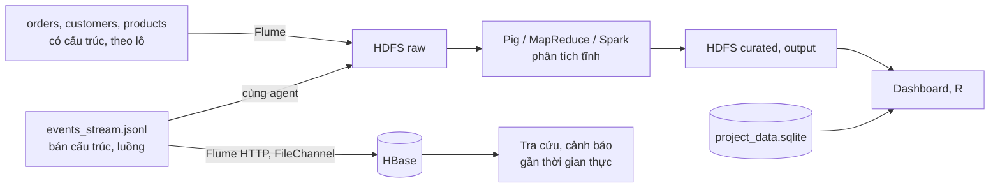

## 1.3. Phân tích đặc trưng Big Data

Nhóm phân tích 3V của Laney [TL:laney2001], mở rộng thành 5V với Veracity và Value [TL:demchenko2013], bổ sung Variability, kèm hệ quả cho thiết kế hệ thống.

### 1.3.1. Volume – Khối lượng

*[Bảng:dung-luong-tep]. Dung lượng các tệp dữ liệu*

| Tệp | Dung lượng (byte) | Số bản ghi |
|---|---:|---:|
| `orders.csv` | 2.298.806 | 15.000 |
| `events_stream.jsonl` | 1.118.573 | 5.000 |
| `project_data.sqlite` | 3.506.176 | 16.600 (3 bảng) |
| `customers.csv` | 62.345 | 1.200 |
| `products.csv` | 20.621 | 400 |
| `data_dictionary.csv` | 2.821 | 39 |
| **Tổng** | **7.009.342** | |

**Nhận xét [Bảng:dung-luong-tep]:** bộ mẫu chỉ khoảng **7,0 MB** (khoảng **26 đơn/ngày**), mỗi tệp nhỏ hơn một block HDFS 128 MB nhưng vẫn tốn một mục metadata trên NameNode [TL:white2015]. Volume của *bài toán* thể hiện khi triển khai thật ([Bảng:uoc-tinh-quy-mo]).

*[Bảng:uoc-tinh-quy-mo]. Ước tính dung lượng khi triển khai thực tế (giả định của nhóm)*

| Giả định | Mỗi ngày | Mỗi năm | Mỗi năm × 3 bản sao |
|---|---:|---:|---:|
| 100.000 đơn/ngày × 153,3 byte | 15,3 MB | 5,6 GB | 16,8 GB |
| 20 sự kiện/đơn × 223,7 byte | 447,4 MB | 163,3 GB | 489,9 GB |
| **Cộng** | **462,7 MB** | **168,9 GB** | **506,7 GB** |

**Nhận xét [Bảng:uoc-tinh-quy-mo]:** riêng vùng raw đã khoảng 0,5 TB/năm, lên mức TB sau vài năm. **Hệ quả:** Flume gom sự kiện thành tệp lớn trước khi ghi HDFS, dữ liệu phân vùng theo thời gian và danh mục, vùng curated dùng Parquet nén.

### 1.3.2. Velocity – Tốc độ

Tốc độ của mẫu thấp, nhưng **62% bản ghi (9.297) nạp qua kênh luồng**; theo [Bảng:uoc-tinh-quy-mo], hệ thống thật nhận khoảng 23 sự kiện/giây, ngày khuyến mại khoảng 230. `events_stream.jsonl` sắp theo mã đơn nên **50,27% cặp sự kiện liên tiếp bị ngược thời gian**, mô phỏng dữ liệu đến muộn, sai thứ tự [TL:akidau2015]. **Hệ quả:** gom cửa sổ theo `event_time` kèm *watermark* [TL:akidau2015]; Flume dùng FileChannel để không mất sự kiện; khóa HBase `customer_id#reverse_timestamp` xếp đúng sự kiện đến muộn.

### 1.3.3. Variety – Đa dạng

- **Định dạng:** CSV UTF-8 có BOM; JSON Lines có đối tượng lồng `payload`; SQLite.
- **Nguồn gốc:** đơn hàng đến từ 5 hệ thống (`source_system`: web, mobile, api, partner, batch) với 3 định dạng ban đầu (`data_format`: CSV, JSON, LOG), phân bố gần đều.
- **Kiểu dữ liệu:** chuỗi, thời điểm ISO 8601, biến phân loại, số, cờ nhị phân, trường được phép rỗng.

**Hệ quả:** từ điển chỉ ghi `TEXT/NUMERIC` nên mỗi công cụ phải khai báo schema theo [Bảng:thuoc-tinh-orders] và xử lý BOM; JSON đọc theo *schema-on-read*.

### 1.3.4. Veracity – Độ tin cậy

`quality_flag` cho thấy **6,03% đơn (905/15.000) có vấn đề**: MISSING 2,09%, OUTLIER 1,98%, DUPLICATE 0,99%, LATE 0,97%. Chỉ OUTLIER phát hiện được bằng luật trên giá trị; luồng sự kiện chứa 321 bản ghi có vấn đề nhưng không mang nhãn; 117/400 sản phẩm có giá niêm yết thấp hơn giá vốn (chi tiết ở mục 2.3).

### 1.3.5. Value – Giá trị

*[Bảng:kpi-danh-muc]. Ba chỉ số mục tiêu theo danh mục (14.408 đơn sạch)*

| Danh mục | Số đơn | Doanh thu ròng | Tỷ lệ trả (%) | Ngày giao TB |
|---|---:|---:|---:|---:|
| Books | 2.953 | 15.741.983,83 | 7,59 | 2,99 |
| Home | 2.616 | 14.257.300,58 | 7,49 | 3,05 |
| Electronics | 2.505 | 14.086.726,93 | 7,54 | 3,06 |
| Sports | 2.280 | 12.994.254,03 | 7,89 | 2,97 |
| Beauty | 2.219 | 11.426.625,74 | 7,62 | 3,11 |
| Fashion | 1.835 | 9.711.450,11 | **8,50** | 3,09 |
| **Toàn sàn** | **14.408** | **78.218.341,22** | **7,73** | **3,04** |

**Nhận xét [Bảng:kpi-danh-muc]:**
- 1.114 đơn bị trả, tương ứng **5.965.840,89 doanh thu bị hoàn (7,6%)**, cao nhất ở Fashion; 7,01% đơn giao quá 5 ngày.
- Tỷ lệ trả chỉ chênh 7,49–8,50% giữa các danh mục: tín hiệu dự báo yếu, giá trị nằm ở **giám sát liên tục** khi tỷ lệ trả *thay đổi*.

### 1.3.6. Variability – Độ biến thiên (đặc trưng bổ sung)

Số đơn theo tháng dao động 693–871, theo giờ 576–670, theo thứ 2.085–2.254: **tải gần như đều**, khác sàn thật có đỉnh buổi tối và ngày khuyến mại. Hệ thống phải định cỡ theo **tải đỉnh**; YARN cấp tài nguyên động nên mở rộng được bằng cách thêm node.

### 1.3.7. Phân tích tĩnh và xử lý gần thời gian thực

Nhóm chia nhu cầu thành hai nhánh theo kiến trúc Lambda [TL:marz2015]: **lớp lô** (toàn bộ lịch sử, chính xác) và **lớp tốc độ** (sự kiện vừa đến, nhanh nhưng tạm thời).

*[Hình:phan-luong-xu-ly]. Phân luồng dữ liệu theo chế độ xử lý tĩnh và gần thời gian thực*

**Nhận xét [Hình:phan-luong-xu-ly]:** sự kiện JSON vào đồng thời HBase (truy cập ngay) và HDFS (lớp lô xử lý lại).

*[Bảng:tinh-vs-thoi-gian-thuc]. Phân chia nhu cầu phân tích theo chế độ xử lý*

| Nhu cầu phân tích | Chế độ | Độ trễ chấp nhận |
|---|---|---|
| Doanh thu, tỷ lệ trả theo danh mục × tỉnh × tháng; sản phẩm tăng trưởng, khách rời bỏ | Tĩnh | Giờ – ngày |
| Hồi quy doanh thu, phân loại trả hàng (SQLite) | Tĩnh | Ngày – tuần |
| Doanh thu theo phút, cảnh báo tỷ lệ trả tăng đột biến (`payload`, cửa sổ `event_time`) | Gần thời gian thực | Giây – phút |
| Tra cứu đơn mới nhất của khách (HBase `customer_id#reverse_timestamp`) | Gần thời gian thực | Mili giây |

**Nhận xét [Bảng:tinh-vs-thoi-gian-thuc]:** nhánh tĩnh cần toàn bộ lịch sử đã làm sạch và **sửa sai cho lớp luồng** (loại DUPLICATE/LATE, tính lại ngưỡng); nhánh gần thời gian thực chỉ dùng 4 trường trong `payload`, chấp nhận kết quả tạm thời.
