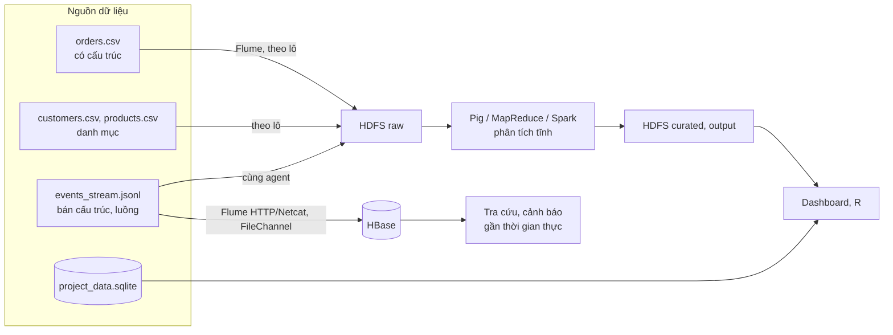

## 1.3. Phân tích đặc trưng Big Data

Nhóm phân tích 3V của Laney [TL:laney2001], mở rộng thành 5V với Veracity và Value [TL:demchenko2013], bổ sung Variability, kèm hệ quả cho thiết kế hệ thống.

### 1.3.1. Volume – Khối lượng

*[Bảng:dung-luong-tep]. Dung lượng các tệp dữ liệu*

| Tệp | Dung lượng (byte) | Số bản ghi | Byte/bản ghi |
|---|---:|---:|---:|
| `orders.csv` | 2.298.806 | 15.000 | 153,3 |
| `events_stream.jsonl` | 1.118.573 | 5.000 | 223,7 |
| `project_data.sqlite` | 3.506.176 | 16.600 (3 bảng) | 211,2 |
| `customers.csv` | 62.345 | 1.200 | 52,0 |
| `products.csv` | 20.621 | 400 | 51,6 |
| `data_dictionary.csv` | 2.821 | 39 | 72,3 |
| **Tổng** | **7.009.342** | | |

**Nhận xét [Bảng:dung-luong-tep]:**
- Bộ dữ liệu mẫu chỉ khoảng **7,0 MB** (15.000 đơn trong 577 ngày, khoảng **26 đơn/ngày**); mỗi tệp nhỏ hơn một block HDFS 128 MB nhưng vẫn tốn một mục metadata trên NameNode [TL:white2015]. Với hệ số nhân bản 3, dung lượng chiếm dụng là **21.028.026 byte**.
- Vậy **bộ dữ liệu mẫu không lớn**; Volume của *bài toán* thể hiện khi triển khai thật, ước tính trong [Bảng:uoc-tinh-quy-mo].

*[Bảng:uoc-tinh-quy-mo]. Ước tính dung lượng khi triển khai thực tế (giả định của nhóm)*

| Giả định | Mỗi ngày | Mỗi năm | Mỗi năm × 3 bản sao |
|---|---:|---:|---:|
| 100.000 đơn/ngày × 153,3 byte | 15,3 MB | 5,6 GB | 16,8 GB |
| 20 sự kiện/đơn × 223,7 byte | 447,4 MB | 163,3 GB | 489,9 GB |
| **Cộng** | **462,7 MB** | **168,9 GB** | **506,7 GB** |

**Nhận xét [Bảng:uoc-tinh-quy-mo]:**
- Riêng vùng raw đã khoảng 0,5 TB/năm; cộng các vùng staging, curated, output (mục 3.2), dữ liệu lên mức TB sau vài năm, cần lưu trữ phân tán và tính toán song song.
- **Hệ quả cho thiết kế:** Flume gom sự kiện thành tệp lớn trước khi ghi HDFS (tránh tệp nhỏ); dữ liệu phân vùng theo thời gian và danh mục; vùng curated dùng Parquet nén.

### 1.3.2. Velocity – Tốc độ

*[Bảng:toc-do]. Các chỉ số về tốc độ phát sinh dữ liệu*

| Chỉ số | Giá trị |
|---|---|
| Số đơn mỗi ngày | trung bình 26, thấp nhất 12, cao nhất 39 (10/01/2025) |
| Chế độ nạp (`ingest_mode`) | **stream 9.297 (62%)**; batch 5.703 (38%) |
| Cặp sự kiện liên tiếp bị ngược thời gian | **50,27%** |

**Nhận xét [Bảng:toc-do]:**
- Tốc độ của mẫu thấp, nhưng **62% bản ghi nạp qua kênh luồng**; theo [Bảng:uoc-tinh-quy-mo], hệ thống thật nhận khoảng 23 sự kiện/giây, ngày khuyến mại khoảng 230.
- `events_stream.jsonl` được sắp theo mã đơn (không tăng theo thời gian) nên **một nửa số cặp sự kiện liên tiếp bị ngược thời gian**, mô phỏng dữ liệu đến muộn, sai thứ tự [TL:akidau2015].
- **Hệ quả cho thiết kế:** xử lý luồng gom cửa sổ theo `event_time` kèm *watermark* [TL:akidau2015]; Flume dùng FileChannel để không mất sự kiện; khóa HBase `customer_id#reverse_timestamp` xếp đúng sự kiện đến muộn.

### 1.3.3. Variety – Đa dạng

Dữ liệu đa dạng ở ba mức:
- **Định dạng tệp:** CSV UTF-8 có BOM (`orders`, `customers`, `products`, `data_dictionary`); JSON Lines có đối tượng lồng `payload`; cơ sở dữ liệu SQLite.
- **Nguồn gốc:** mỗi đơn ghi hệ thống sinh ra nó (`source_system`: web 3.001, mobile 3.020, api 2.899, partner 3.002, batch 3.078) và định dạng ban đầu (`data_format`: CSV 4.949, JSON 5.010, LOG 5.041); hệ thống thật phải đọc cả ba định dạng từ năm nguồn.
- **Kiểu dữ liệu trong một bản ghi:** mã chuỗi, thời điểm ISO 8601, biến phân loại (18 tỉnh, 6 danh mục, 4 phân khúc, 3 kênh bán, 4 phương thức thanh toán), số nguyên, số thực, cờ nhị phân, trường được phép rỗng.

**Hệ quả cho thiết kế:** từ điển dữ liệu chỉ ghi `TEXT/NUMERIC`, nên mỗi công cụ phải khai báo schema theo [Bảng:thuoc-tinh-orders] và xử lý BOM; JSON đọc theo *schema-on-read*.

### 1.3.4. Veracity – Độ tin cậy

`quality_flag` cho thấy **6,03% đơn hàng (905/15.000) có vấn đề chất lượng**: MISSING 2,09%, OUTLIER 1,98%, DUPLICATE 0,99%, LATE 0,97%. Ba điểm ảnh hưởng tới thiết kế (chi tiết ở mục 2.3):
1. Chỉ OUTLIER phát hiện được bằng luật trên giá trị; DUPLICATE và LATE phải loại theo nhãn.
2. Luồng sự kiện chứa 321 bản ghi có vấn đề nhưng không mang nhãn, nên xử lý luồng phải tự kiểm tra theo ngưỡng.
3. 117/400 sản phẩm có giá niêm yết thấp hơn giá vốn, không dùng để tính lợi nhuận.

### 1.3.5. Value – Giá trị

*[Bảng:kpi-danh-muc]. Ba chỉ số mục tiêu theo danh mục (14.408 đơn sạch)*

| Danh mục | Số đơn | Doanh thu ròng | Tỷ lệ trả (%) | Ngày giao TB |
|---|---:|---:|---:|---:|
| Books | 2.953 | 15.741.983,83 | 7,59 | 2,99 |
| Home | 2.616 | 14.257.300,58 | 7,49 | 3,05 |
| Electronics | 2.505 | 14.086.726,93 | 7,54 | 3,06 |
| Sports | 2.280 | 12.994.254,03 | 7,89 | 2,97 |
| Beauty | 2.219 | 11.426.625,74 | 7,62 | 3,11 |
| Fashion | 1.835 | 9.711.450,11 | **8,50** | 3,09 |
| **Toàn sàn** | **14.408** | **78.218.341,22** | **7,73** | **3,04** |

**Nhận xét [Bảng:kpi-danh-muc]:**
- Dữ liệu trả lời trực tiếp ba mục tiêu: doanh thu trung bình 5.428,81/đơn; 1.114 đơn bị trả, tương ứng **5.965.840,89 doanh thu bị hoàn (7,6%)**, cao nhất ở Fashion; 90% số đơn giao trong 5 ngày, 7,01% giao quá 5 ngày.
- Tỷ lệ trả chỉ chênh 7,49–8,50% giữa các danh mục và 6,47–8,38% giữa các mức số ngày giao, nên tín hiệu dự báo trả hàng yếu; giá trị lớn hơn nằm ở **giám sát liên tục** để phát hiện khi tỷ lệ trả *thay đổi*.

### 1.3.6. Variability – Độ biến thiên (đặc trưng bổ sung)

- Số đơn theo tháng dao động 693–871 (trung bình 789), chủ yếu do số ngày trong tháng.
- Theo giờ (576–670 đơn) và theo thứ (2.085–2.254 đơn), **tải gần như đều**, khác sàn thật có đỉnh buổi tối và ngày khuyến mại.
- **Hệ quả:** hệ thống phải định cỡ theo **tải đỉnh**; YARN cấp tài nguyên động nên mở rộng được bằng cách thêm node.

### 1.3.7. Phân tích tĩnh và xử lý gần thời gian thực

Nhóm chia nhu cầu phân tích thành hai nhánh theo kiến trúc Lambda [TL:marz2015]: **lớp lô** (toàn bộ lịch sử, chính xác) và **lớp tốc độ** (sự kiện vừa đến, nhanh nhưng tạm thời).

*[Hình:phan-luong-xu-ly]. Phân luồng dữ liệu theo chế độ xử lý tĩnh và gần thời gian thực*

**Nhận xét [Hình:phan-luong-xu-ly]:** dữ liệu có cấu trúc đi theo nhánh lô; sự kiện JSON đi đồng thời vào HBase để truy cập ngay và vào HDFS để lớp lô xử lý lại.

*[Bảng:tinh-vs-thoi-gian-thuc]. Phân chia nhu cầu phân tích theo chế độ xử lý*

| Nhu cầu phân tích | Chế độ | Dữ liệu sử dụng | Độ trễ chấp nhận |
|---|---|---|---|
| Doanh thu, tỷ lệ trả theo danh mục × tỉnh × tháng | Tĩnh | `orders` (sạch) | Giờ – ngày |
| Sản phẩm tăng trưởng nhanh, khách có nguy cơ rời bỏ | Tĩnh | `orders` + `products` + `customers` | Ngày |
| Hồi quy doanh thu, phân loại khả năng trả hàng | Tĩnh | SQLite `fact_main`, `entity_master`, `item_master` | Ngày – tuần |
| Dashboard, đánh giá chất lượng dữ liệu | Tĩnh | Vùng output; `quality_flag` | Ngày |
| Doanh thu, số đơn theo phút trong ngày khuyến mại | Gần thời gian thực | `events`: `event_time`, `payload.net_revenue`, `payload.category` | Giây – phút |
| Cảnh báo tỷ lệ trả tăng đột biến theo danh mục | Gần thời gian thực | `events`: `payload.returned_flag`, cửa sổ theo `event_time` | Phút |
| Tra cứu các đơn mới nhất của một khách hàng | Gần thời gian thực | HBase, khóa `customer_id#reverse_timestamp` | Mili giây |
| Gắn cờ đơn bất thường ngay khi phát sinh | Gần thời gian thực | `payload.net_revenue` so với ngưỡng do lớp lô tính | Giây |

**Nhận xét [Bảng:tinh-vs-thoi-gian-thuc]:**
- **Phân tích tĩnh** dành cho câu hỏi cần toàn bộ lịch sử đã làm sạch, ghép đủ ba bảng hoặc mô hình thống kê; lớp lô cũng **sửa sai cho lớp luồng** (loại DUPLICATE/LATE, tính lại ngưỡng ngoại lệ).
- **Xử lý gần thời gian thực** dành cho quyết định mất giá trị nếu chậm; chỉ dùng 4 trường trong `payload`, chấp nhận kết quả tạm thời và phải xử lý theo `event_time`.
