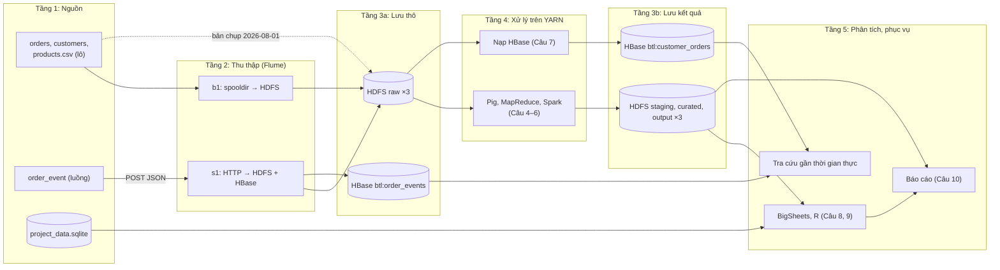

## 1.5. Kiến trúc tổng thể hệ thống

Hệ thống theo kiến trúc Lambda [TL:marz2015], cụ thể hóa [Hình:phan-luong-xu-ly]: lớp lô xử lý toàn bộ lịch sử trên HDFS, lớp tốc độ đưa sự kiện mới vào HBase để tra cứu ngay. [Hình:c02-kien-truc-tong-the] gồm năm tầng.

*[Hình:c02-kien-truc-tong-the]. Kiến trúc thu thập, lưu trữ và xử lý dữ liệu đầu–cuối*

**Nhận xét [Hình:c02-kien-truc-tong-the]:**
- **Hai đường vào tách biệt** (`b1` cho lô, `s1` cho luồng); mỗi sự kiện được ghi cả vào HDFS (bền vững) và HBase (độ trễ thấp), chi tiết ở mục 3.3.
- **Raw là nguồn sự thật duy nhất:** mọi công cụ đọc cùng bản chụp `ingest_date=2026-08-01`, nên kết quả đối chiếu được và HBase hay curated hỏng vẫn tính lại được. SQLite là nguồn riêng của Câu 9; BigSheets (Câu 8) được mô phỏng bằng R.

*[Bảng:c02-tang-kien-truc]. Các tầng của kiến trúc và cơ chế chịu lỗi*

| Tầng | Thành phần | Cơ chế chịu lỗi |
|---|---|---|
| 1. Nguồn | 3 tệp CSV, luồng `order_event`, SQLite | Tệp gốc không bị xóa (đổi tên `.COMPLETED`); luồng phát lại được |
| 2. Thu thập | Flume `b1` (spooldir), `s1` (HTTP) | Giao dịch, FileChannel ghi đĩa, client gửi lại khi nhận HTTP 503 |
| 3. Lưu trữ (3a thô, 3b kết quả) | HDFS 4 vùng; HBase 2 bảng | Nhân bản 3; WAL, gán lại region |
| 4. Xử lý | Pig, MapReduce, Spark, trình nạp HBase | YARN chạy lại container lỗi; Spark tính lại từ lineage |
| 5. Phục vụ | Dashboard, R, tra cứu HBase | Tạo lại được từ các vùng dưới |

**Nhận xét [Bảng:c02-tang-kien-truc]:** mỗi tầng chỉ phụ thuộc tầng dưới qua **giao diện cố định** (đường dẫn HDFS, tên bảng HBase), nên các thành viên làm song song được. Điểm yếu còn lại là **NameNode và HMaster chỉ có một bản** (mục 3.2.1).
