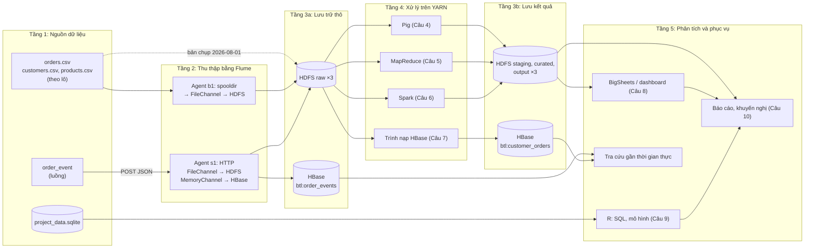

## 1.5. Kiến trúc tổng thể hệ thống

Hệ thống theo kiến trúc Lambda [TL:marz2015], cụ thể hóa sơ đồ phân luồng ở [Hình:phan-luong-xu-ly]: lớp lô xử lý toàn bộ lịch sử trên HDFS, lớp tốc độ đưa sự kiện mới vào HBase để tra cứu ngay. Kiến trúc gồm năm tầng ([Hình:c02-kien-truc-tong-the]); YARN cấp tài nguyên cho mọi job của tầng xử lý.

*[Hình:c02-kien-truc-tong-the]. Kiến trúc thu thập, lưu trữ và xử lý dữ liệu đầu–cuối*

**Nhận xét [Hình:c02-kien-truc-tong-the]:**
- **Hai đường vào tách biệt** (`b1` cho lô, `s1` cho luồng); mỗi sự kiện được ghi cả vào HDFS (bền vững) và HBase (độ trễ thấp), chi tiết ở mục 3.3.
- **Raw là nguồn sự thật duy nhất:** mọi công cụ đọc cùng bản chụp `ingest_date=2026-08-01`, nên kết quả đối chiếu được và HBase hay curated hỏng vẫn tính lại được.
- SQLite là nguồn riêng của Câu 9, phân tích bằng R; không có IBM BigInsights nên BigSheets (Câu 8) được mô phỏng bằng R.

*[Bảng:c02-tang-kien-truc]. Các tầng của kiến trúc và thành phần đảm nhận*

| Tầng | Thành phần | Cơ chế chịu lỗi | Câu |
|---|---|---|---|
| 1. Nguồn | Tệp CSV, luồng `order_event`, SQLite | – | 1 |
| 2. Thu thập | Flume `b1` (spooldir), `s1` (HTTP) | Giao dịch, FileChannel ghi đĩa, client gửi lại khi nhận HTTP 503 | 2 |
| 3. Lưu trữ | HDFS 4 vùng; HBase 2 bảng | Nhân bản 3; WAL, gán lại region | 3, 7 |
| 4. Xử lý | Pig, MapReduce, Spark, trình nạp HBase trên YARN | YARN chạy lại container/task lỗi; Spark tính lại từ lineage | 4–7 |
| 5. Phân tích, phục vụ | BigSheets/R dashboard, R, tra cứu HBase | Tạo lại được từ các vùng dưới | 8–10 |

**Nhận xét [Bảng:c02-tang-kien-truc]:**
- Mỗi tầng chỉ phụ thuộc tầng dưới qua **giao diện cố định** (đường dẫn HDFS, tên bảng HBase đã chốt), nên năm thành viên làm song song và có thể thay một công cụ mà không sửa tầng khác.
- Khả năng chịu lỗi có ở mọi tầng; điểm yếu còn lại là **NameNode và HMaster chỉ có một bản** (mục 3.2.1).
