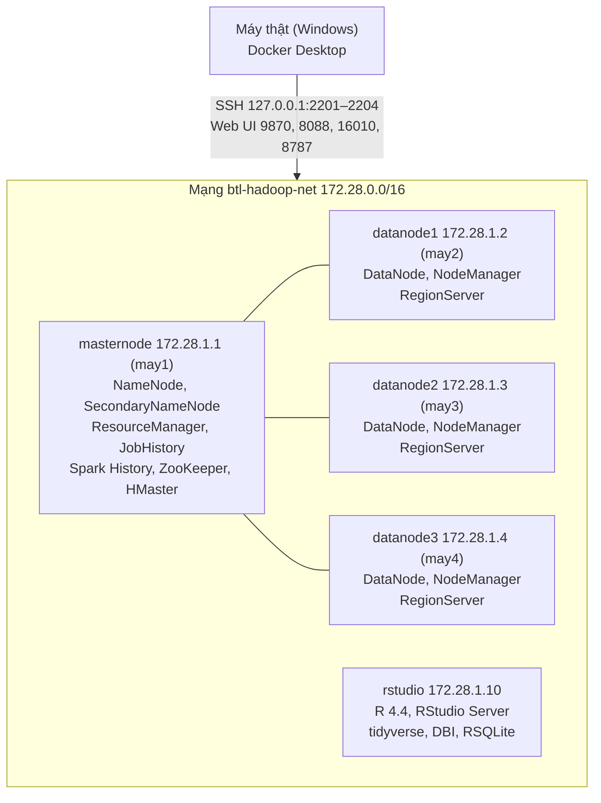

## 3.1. Môi trường triển khai

Hệ thống chạy trên một **cụm Hadoop 4 node** cộng **1 máy R**, mô phỏng bằng Docker Compose trên một máy tính cá nhân. Mỗi container là một máy chủ có IP riêng, truy cập qua SSH như máy thật (`ssh may1` … `ssh may4`).

*[Hình:moi-truong-cum]. Sơ đồ cụm triển khai*

**Nhận xét [Hình:moi-truong-cum]:**
- Masternode giữ các dịch vụ quản lý; ba datanode giữ dữ liệu và chạy tác vụ, nên hỏng một datanode vẫn còn đủ bản sao (mục 3.2.1).
- Thư mục `data/` được gắn chỉ đọc để dữ liệu gốc không bị sửa nhầm; `src/` gắn đọc/ghi để mã sửa trên máy thật được dùng ngay trong cụm.

*[Bảng:phien-ban]. Phần mềm và phiên bản*

| Thành phần | Phiên bản | Vai trò trong đề tài |
|---|---|---|
| Ubuntu | 20.04 | Hệ điều hành 4 node Hadoop |
| OpenJDK | 1.8 | Chạy Hadoop/HBase/Pig/Flume; biên dịch MapReduce |
| Apache Hadoop (HDFS, YARN, MapReduce) | 3.2.2 | Câu 3, 5 |
| Apache Spark (PySpark, Python 3.8) | 3.1.2 | Câu 6 |
| Apache Pig | 0.17.0 | Câu 4 |
| Apache Flume | 1.11.0 | Câu 2 |
| Apache HBase (kèm ZooKeeper) | 2.5.16 | Câu 7 |
| R, tidyverse, DBI, RSQLite, broom | 4.4 | Câu 8, 9 |
| Docker Desktop, Docker Compose | — | Dựng cụm 5 container |

**Nhận xét [Bảng:phien-ban]:** mỗi câu của đề bài có một công cụ đảm nhận; mọi thành viên dùng chung một image Docker nên chạy cùng phiên bản.

*[Bảng:cau-hinh-cum]. Cấu hình tài nguyên chính của cụm*

| Tham số | Giá trị | Ý nghĩa |
|---|---|---|
| `dfs.replication` | 3 | Mỗi block có 3 bản sao |
| `dfs.blocksize` | 134.217.728 byte (128 MB) | Kích thước block HDFS |
| `dfs.namenode.heartbeat.recheck-interval` | 60.000 ms | Coi DataNode là hỏng sau khoảng 2,5 phút (mặc định 10,5 phút) |
| `yarn.nodemanager.resource.memory-mb` / `cpu-vcores` | 2.560 MB / 2 mỗi node | Tổng 7,5 GB và 6 vcore cho YARN |
| MapReduce map/reduce/AM memory | 1.024 MB | Bộ nhớ mỗi container |
| Spark executor | 2 executor × 1 GB × 1 core; `spark.sql.shuffle.partitions` = 12 | Phù hợp cụm nhỏ (mục 4.4) |
| Heap NameNode/DataNode, HBase | 768 MB | Để cả cụm vừa khoảng 10 GB RAM |

**Nhận xét [Bảng:cau-hinh-cum]:** cấu hình được thu nhỏ để chạy trên máy 16 GB RAM (khi rảnh, cụm dùng khoảng 4,6 GB) nhưng giữ đúng bản chất đề bài: nhân bản 3 lần, phân tán trên 3 node, phát hiện node hỏng đủ nhanh để demo khôi phục.

**Khả năng tái lập:** toàn bộ môi trường được mô tả bằng mã (`docker-compose.yml`, Dockerfile, cấu hình trong `infra/`). GitHub Actions build image lên GitHub Container Registry, dựng lại cụm 4 node, chạy smoke test và `test.sh` của từng câu sau mỗi thay đổi. Người chấm chỉ cần Docker (Phụ lục A).
