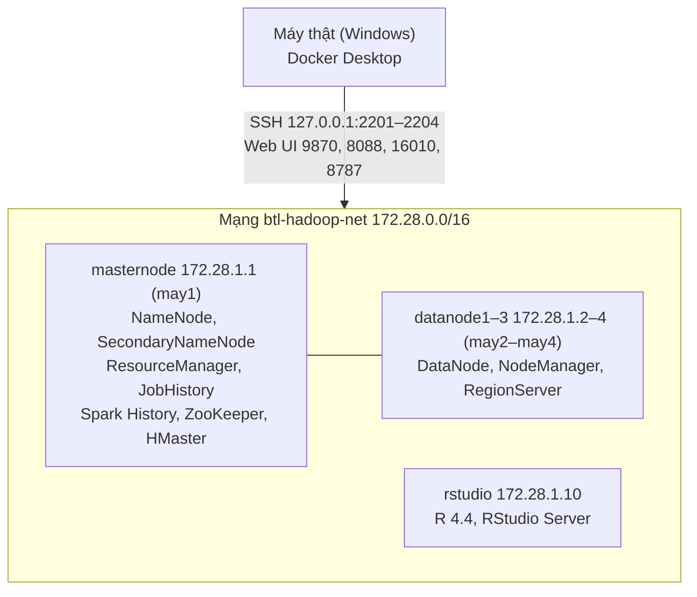

## 3.1. Môi trường triển khai

Hệ thống chạy trên một **cụm Hadoop 4 node** cộng **1 máy R**, mô phỏng bằng Docker Compose trên một máy tính cá nhân. Mỗi container có IP riêng, truy cập qua SSH như máy thật (`ssh may1` … `ssh may4`).

*[Hình:moi-truong-cum]. Sơ đồ cụm triển khai*

**Nhận xét [Hình:moi-truong-cum]:** masternode giữ dịch vụ quản lý, ba datanode giữ dữ liệu và chạy tác vụ, nên hỏng một datanode vẫn đủ bản sao (mục 3.2.1). Thư mục `data/` gắn chỉ đọc để dữ liệu gốc không bị sửa nhầm.

*[Bảng:phien-ban]. Phần mềm và phiên bản*

| Thành phần | Phiên bản | Câu |
|---|---|---|
| Ubuntu / OpenJDK | 20.04 / 1.8 | Nền cho mọi node |
| Hadoop (HDFS, YARN, MapReduce) | 3.2.2 | 3, 5 |
| Spark (PySpark, Python 3.8) | 3.1.2 | 6 |
| Pig / Flume | 0.17.0 / 1.11.0 | 4 / 2 |
| HBase (kèm ZooKeeper) | 2.5.16 | 7 |
| R, tidyverse, DBI, RSQLite, broom | 4.4 | 8, 9 |

**Nhận xét [Bảng:phien-ban]:** mỗi câu có một công cụ đảm nhận; mọi thành viên dùng chung một image Docker nên chạy cùng phiên bản.

*[Bảng:cau-hinh-cum]. Cấu hình tài nguyên chính của cụm*

| Tham số | Giá trị |
|---|---|
| `dfs.replication` / `dfs.blocksize` | 3 / 128 MB |
| `dfs.namenode.heartbeat.recheck-interval` | 60.000 ms (coi DataNode hỏng sau khoảng 2,5 phút thay vì 10,5 phút) |
| YARN mỗi node | 2.560 MB, 2 vcore (tổng 7,5 GB, 6 vcore) |
| MapReduce map/reduce/AM | 1.024 MB |
| Spark executor | 2 × 1 GB × 1 core; `spark.sql.shuffle.partitions` = 12 |
| Heap NameNode/DataNode, HBase | 768 MB |

**Nhận xét [Bảng:cau-hinh-cum]:** cấu hình thu nhỏ để chạy trên máy 16 GB RAM (khi rảnh cụm dùng khoảng 4,6 GB) nhưng giữ bản chất đề bài: nhân bản 3 lần, phân tán trên 3 node, phát hiện node hỏng đủ nhanh để demo khôi phục.

**Khả năng tái lập:** môi trường được mô tả bằng mã (`docker-compose.yml`, Dockerfile, `infra/`); GitHub Actions build image, dựng lại cụm và chạy `test.sh` của từng câu sau mỗi thay đổi. Người chấm chỉ cần Docker (Phụ lục A).
