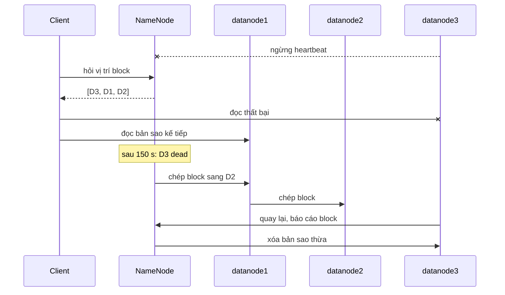

### 3.2.1. Vùng dữ liệu trên HDFS

#### a) Thiết kế bốn vùng dữ liệu

Dữ liệu trên HDFS chia thành bốn vùng theo mức độ xử lý; mỗi vùng có một chủ ghi duy nhất nên các thành viên làm song song mà không ghi đè lên nhau.

*[Bảng:c03-vung-du-lieu]. Bốn vùng dữ liệu trên HDFS*

| Vùng | Đường dẫn | Nội dung, định dạng | Ai ghi | Lưu giữ đề xuất |
|---|---|---|---|---|
| raw | `/btl/raw/<bảng>/ingest_date=YYYY-MM-DD/` | Nguyên văn nguồn: CSV còn BOM và tiêu đề, JSON Lines | `init_zones.sh` (bản chụp), Flume (Câu 2) | 1 năm nhân bản 3, sau đó lưu trữ lạnh |
| staging | `/btl/staging/<bảng>/` | Đã làm sạch, phân tách bằng tab | Pig (Câu 4) | 30 ngày (tạo lại được từ raw) |
| curated | `/btl/curated/orders/year=YYYY/month=MM/category=<cat>/` | Parquet nén Snappy, có kiểu | Spark (Câu 6) | Lâu dài |
| output | `/btl/output/cau04_pig/`, `cau05_mr/`, `cau06_spark/` | Bảng tổng hợp nhỏ | Từng câu | Ghi đè mỗi lần chạy |

Câu 7 dùng thêm `/btl/backup/hbase/` cho snapshot HBase. Cây thư mục thực tế ở Phụ lục B (B.7).

**Nhận xét [Bảng:c03-vung-du-lieu]:**
- **Raw phân vùng theo ngày nạp** (`ingest_date`): dữ liệu đến muộn hay sai thứ tự (50,27% cặp sự kiện liên tiếp, mục 1.3.2) vẫn vào partition của ngày nhận, nên partition cũ không phải sửa. Bản chụp `ingest_date=2026-08-01` là đầu vào chung của Pig, MapReduce, Spark; Flume chỉ thêm partition mới.
- **Curated phân vùng theo tháng × danh mục**, hai chiều lọc chính, nên Spark chỉ đọc thư mục cần (*partition pruning*). Ở quy mô 100.000 đơn/ngày (mục 1.3.1), mỗi partition khoảng 19,8 MB; chia tới ngày chỉ còn khoảng 0,66 MB, sinh nhiều tệp nhỏ.

#### b) Dung lượng thực tế khi nhân bản 3 lần

*[Bảng:c03-dung-luong-thuc-te]. Dung lượng các vùng trên cụm (`hdfs dfs -du -s`, `hdfs dfs -count`; 11/10/2026 23:21)*

| Vùng | Số tệp | Dung lượng logic (byte) | Chiếm dụng × 3 (byte) | % một block 128 MiB |
|---|---:|---:|---:|---:|
| raw (bản chụp + partition Flume) | 8 | 7.224.382 | 21.673.146 | 0,6728 |
| staging | 4 | 2.308.599 | 6.925.797 | 0,4300 |
| curated | 115 | 2.352.399 | 7.057.197 | 0,0152 |
| output | 61 | 446.959 | 1.340.877 | 0,0055 |
| HBase `btl:order_events` | – | 388.094 | 1.164.282 | – |

**Nhận xét [Bảng:c03-dung-luong-thuc-te]:**
- **Hệ số chiếm dụng đúng bằng 3**, kể cả HBase. `hdfs fsck /btl`: 208 tệp, 191 block, 0 block thiếu bản sao, HEALTHY.
- **Tệp nhỏ:** tệp lớn nhất chỉ dùng 0,67% một block; mỗi tệp, block chiếm khoảng 150 byte RAM NameNode [TL:white2015]. Curated còn lớn hơn raw `orders` do metadata Parquet.

*[Bảng:c03-dinh-dang]. Dung lượng và số tệp theo định dạng lưu (`output/parquet_probe.txt`)*

| Tập dữ liệu | Byte | Số tệp | Tỷ lệ so với raw |
|---|---:|---:|---:|
| `orders` raw CSV (15.000 dòng) | 2.298.806 | 1 | 1,000 |
| `orders` sạch (14.408 dòng), Parquet Snappy 1 tệp | 594.099 | 1 | **0,258** |
| `orders` sạch, Parquet phân vùng, 1 tệp mỗi partition | 1.388.160 | 114 | 0,604 |
| `orders` sạch, Parquet phân vùng, 12 task cùng ghi | 8.931.807 | 1.368 | **3,885** |
| `events` raw JSON Lines | 1.118.573 | 1 | 1,000 |
| `events` phẳng, Parquet Snappy 1 tệp | 111.343 | 1 | **0,100** |

**Nhận xét [Bảng:c03-dinh-dang]:**
- Parquet nén tốt khi tệp đủ lớn (JSON lặp tên khóa ở mọi dòng nên lợi nhất) [TL:white2015]; phần dự báo dùng tỷ lệ bản một tệp vì ở quy mô thật mỗi partition khoảng 20 MB.
- Với dữ liệu nhỏ, phân vùng làm mất lợi ích nén; ghi mà không gom theo khóa phân vùng thì gấp 3,9 lần raw, nên Câu 6 gọi `repartition(year, month, category)` trước `partitionBy`.

#### c) Dự báo dung lượng khi nhân bản 3 lần

Giả định giống mục 1.3.1: 100.000 đơn/ngày, mỗi đơn 20 sự kiện, tức raw `orders` 5,6 GB/năm và raw `events` 163,3 GB/năm.

*[Bảng:c03-du-bao-dung-luong]. Dự báo dung lượng HDFS năm đầu tiên (GB, hệ thập phân)*

| Vùng | Cách tính | Logic | × 3 bản sao |
|---|---|---:|---:|
| raw (giữ 1 năm) | 5,6 + 163,3 | 168,9 | **506,7** |
| staging (giữ 30 ngày) | orders × 1,004 × 30/365 | 0,46 | 1,4 |
| curated `orders` | 5,6 × 0,258 | 1,45 | 4,3 |
| curated `events` | 163,3 × 0,100 | 16,25 | 48,8 |
| output | Giả định ≤ 1 GB | ≤ 1 | ≤ 3 |
| HBase `btl:order_events` (TTL 180 ngày) | 2.000.000 sự kiện/ngày × 77,6 byte × 180 ngày | 27,9 | 83,8 |
| **Cộng** | | **≈ 216** | **≈ 648** |

**Nhận xét [Bảng:c03-du-bao-dung-luong]:**
- Raw chiếm 78%. Giữ mức sử dụng dưới khoảng 70%, năm đầu cần khoảng **0,93 TB**; bảng chưa tính `btl:customer_orders` (mục 3.2.2).
- Dùng *erasure coding* `XOR-2-1-1024k` cho raw sau 90 ngày [TL:hdfs-ec] thì raw còn khoảng **315,8 GB/năm** thay vì 506,7 GB (tiết kiệm 38%), đổi lại đọc chậm hơn và chỉ chịu hỏng 1 node.

#### d) Vai trò của NameNode, DataNode và YARN trong cụm

*[Bảng:c03-vai-tro]. Vai trò các tiến trình HDFS và YARN và cấu hình trong cụm*

| Tiến trình | Vai trò | Cấu hình đáng chú ý |
|---|---|---|
| NameNode (masternode) | Giữ không gian tên và bản đồ block trong RAM; ghi *edit log*; quyết định nơi đặt bản sao | Hệ số 3, block 128 MiB; fsimage 37.095 byte |
| SecondaryNameNode (masternode) | Định kỳ gộp fsimage và edit log; **không phải** NameNode dự phòng | Mỗi giờ một lần |
| DataNode (datanode1–3) | Lưu block; heartbeat 3 s/lần; chuyển tiếp block theo pipeline khi ghi | Bị coi là chết sau 2 × 60 s + 10 × 3 s = **150 s** (mặc định 630 s) |
| ResourceManager (masternode) | Cấp container, khởi động ApplicationMaster của mỗi job | Container 512–2.560 MB |
| NodeManager (datanode1–3) | Chạy container, chạy shuffle MapReduce | 2.560 MB, 2 vcore mỗi node |

**Nhận xét [Bảng:c03-vai-tro]:**
- DataNode và NodeManager chung máy nên YARN chạy task trên node giữ block (*data locality*) [TL:vavilapalli2013].
- Với 3 DataNode và hệ số 3, mỗi node giữ bản sao của mọi block. **NameNode là điểm hỏng duy nhất** [TL:shvachko2010].

#### e) Phương án khôi phục khi một node hỏng

*[Hình:c03-khoi-phuc-datanode]. Trình tự HDFS xử lý khi một DataNode hỏng rồi quay lại*

**Nhận xét [Hình:c03-khoi-phuc-datanode]:** client chuyển sang bản sao khác ngay, không chờ NameNode. NameNode chỉ chép lại block khi còn node chưa giữ block đó; node quay lại với đĩa nguyên vẹn làm block đủ bản sao mà không phải chép.

*[Bảng:c03-khoi-phuc]. Phương án khôi phục theo từng loại sự cố*

| Sự cố | Tự động khôi phục | Việc của người quản trị |
|---|---|---|
| DataNode hỏng | Đọc bản sao khác; nhân bản lại nếu còn node trống | Sửa node, khởi động DataNode; theo dõi `hdfs fsck /` |
| NodeManager hỏng | Chạy lại task trên node khác (MapReduce tối đa 4 lần/task); Spark tính lại từ lineage | Khởi động lại NodeManager |
| RegionServer hỏng | HMaster chia WAL, gán region sang RegionServer khác [TL:white2015] | Bật lại RegionServer |
| NameNode hỏng | **Không** (chỉ có 1 NameNode) | Khởi động lại từ fsimage + edit log, hoặc fsimage sao lưu bằng `hdfs dfsadmin -fetchImage` |
| Flume agent sập | FileChannel phát lại log (mục 3.3.3) | Dùng systemd/supervisor tự khởi động lại |

**Nhận xét [Bảng:c03-khoi-phuc]:**
- **Đề xuất cho triển khai thật:** NameNode HA với Quorum Journal Manager [TL:hdfs-ha]; sao lưu fsimage hằng ngày; tối thiểu 4 DataNode; bật rack awareness.
- **Giới hạn môi trường:** ba DataNode nằm trên **cùng một ổ đĩa** máy thật, nên chỉ chống hỏng tiến trình/container; ngưỡng 150 s được rút ngắn để demo.

**Kịch bản demo** (`recovery_demo.sh`, Phụ lục B.6): tạo tệp hệ số 3 và tệp `orders_x4_rep2.csv` (hệ số 2, 9 block), `docker stop datanode3`, đọc lại, chờ nhân bản lại, rồi bật lại node.

*[Bảng:c03-demo-khoi-phuc]. Diễn biến khi tắt datanode3 (mốc tính từ lúc `docker stop`)*

| Mốc | Thời điểm | Trạng thái quan sát được |
|---|---:|---|
| Tắt datanode3 | 0 s | Đọc lại ngay hai tệp demo: md5 khớp tệp gốc |
| NameNode loại datanode3 | 164 s | `dfsadmin` báo 2 sống, 1 chết. `fsck /btl`: 192/192 block thiếu bản sao, hệ số trung bình 2,0, vẫn **HEALTHY** (0 block mất) |
| Tệp hệ số 2 được nhân bản lại | 170 s | Cả 9 block lại đủ 2 bản sao trên datanode1 và datanode2 |
| YARN | – | NodeManager của datanode3 chuyển SHUTDOWN ngay (tắt đột ngột thì sau 10 phút mới thành LOST) |
| Bật lại datanode3 | 179 s | Bật lại DataNode, NodeManager, RegionServer |
| DataNode được tính sống lại | 191 s | Gửi block report |
| HDFS trở lại bình thường | 196 s | `fsck /btl`: 0 block thiếu bản sao, hệ số trung bình 3,0 |

**Nhận xét [Bảng:c03-demo-khoi-phuc]:**
- **Không mất dữ liệu, không gián đoạn đọc.** Tệp hệ số 2 được nhân bản lại 6 s sau khi node bị loại; dữ liệu hệ số 3 chỉ còn 2 bản sao tới khi node quay lại, nên cụm thật cần ít nhất 4 DataNode. Với cấu hình mặc định, thời gian loại node khoảng 10,5 phút.
- **Sự cố phát hiện nhờ demo:** lần đầu HMaster tự hủy vì `replace-datanode-on-failure.policy = NEVER` chỉ đặt trong `hdfs-site.xml`; sau khi thêm vào `hbase-site.xml`, HBase hoạt động suốt quá trình (`btl:customer_orders` đủ 14.408 dòng).
