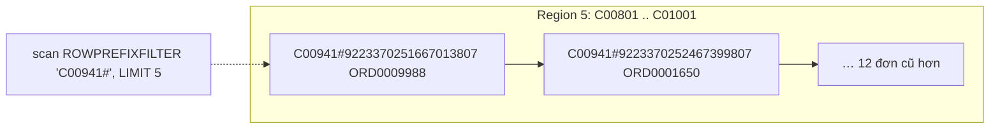

### 3.2.2. Thiết kế bảng HBase

Bảng `btl:customer_orders` phục vụ **truy cập ngẫu nhiên**: lấy N đơn mới nhất của một khách, đọc và cập nhật trạng thái một đơn. Mã nguồn: `src/cau07_hbase/` (Phụ lục B).

**a) RowKey `customer_id#reverse_timestamp`**

`reverse_timestamp = Long.MAX_VALUE − epoch_ms` của giờ đặt hàng (19 chữ số). Rowkey sắp theo byte nên đơn của một khách **nằm liền nhau**, **mới nhất đứng đầu**: "N đơn mới nhất" là một lần quét tiền tố với `LIMIT N`. Tiền tố là mã khách chứ không phải thời gian nên lượt ghi rải đều các region, tránh *hotspot* [TL:george2011]; thực tế nên thêm hậu tố `#order_id` phòng trùng mili giây.

*[Hình:c07-rowkey]. Bố trí dòng theo rowkey `customer_id#reverse_timestamp` và truy vấn đơn mới nhất của một khách*

**Nhận xét [Hình:c07-rowkey]:** truy vấn chỉ chạm một region và trả về ORD0009988, ORD0001650, ORD0008333, ORD0001228, ORD0003359 đúng thứ tự mới đến cũ.

**b) Column family, phiên bản và timestamp**

*[Bảng:c07-column-family]. Ba column family của `btl:customer_orders`*

| CF | Cột (qualifier) | VERSIONS |
|---|---|---:|
| `o` – thông tin đơn | `order_id`, `ts`, `product_id`, … (12 cột) | 1 |
| `m` – tiền | `quantity`, `unit_price`, `discount_rate`, `shipping_fee`, `net_revenue` | 1 |
| `d` – giao hàng, phản hồi | `delivery_days`, `returned_flag`, `review_score`, `status` | **5** |

**Nhận xét [Bảng:c07-column-family]:** mỗi CF là một nhóm HFile riêng nên cập nhật trạng thái chỉ ghi vào `d` (phần duy nhất thay đổi), còn `m` có thể cấp quyền riêng; ô trống không được ghi (tương đương NULL).

**Timestamp của ô = thời điểm nghiệp vụ**: `d:status` có các phiên bản `PLACED` (lúc đặt), `DELIVERED` (đặt + `delivery_days` ngày) và `RETURNED` (giao + 1 ms), nên `TIMERANGE` trả lời được "trạng thái đơn ORD0013507 ngày 30/09/2025" (PLACED, Phụ lục B).

**c) TTL**

Cả ba CF đặt `TTL => 94.608.000 giây (3 năm)`, tính theo timestamp của ô: bảng chỉ lưu trực tuyến đơn 3 năm gần nhất, đơn tháng 01/2025 tự biến mất từ tháng 01/2028 (xóa hẳn ở major compaction), bản đầy đủ vẫn ở vùng curated.

**d) Pre-splitting**

Bảng được tạo sẵn 6 region với 5 điểm chia `C00201`, `C00401`, `C00601`, `C00801`, `C01001`. Sau khi nạp, mỗi region giữ 200 khách và 2.332–2.452 dòng, mỗi RegionServer đúng 2 region, nên tải chia đều cho 3 máy ngay từ đầu (Phụ lục B, [Bảng:c07-pre-split]).

**e) Nén và mã hóa khối**

*[Bảng:c07-nen]. Dung lượng HFile của cùng 14.408 đơn với hai cấu hình (1 bản sao)*

| Cấu hình CF | Dung lượng (byte) | So với không nén |
|---|---:|---:|
| Không nén (`NONE`) | 19.950.384 | 100% |
| `SNAPPY` + `FAST_DIFF` (chọn) | 3.446.349 | 17,3% |
| `orders.csv` (tham chiếu) | 2.298.806 | – |

**Nhận xét [Bảng:c07-nen]:** không nén, HBase gấp 8,7 lần CSV vì mỗi ô lặp lại rowkey, CF, qualifier, timestamp; `FAST_DIFF` chỉ lưu phần khác giữa các khóa liền kề, Snappy nén tiếp, còn gấp 1,5 lần CSV.

**f) Sao lưu**

Snapshot `customer_orders_snap` mất khoảng 1 giây; `clone_snapshot` cho đúng 14.408 dòng; `ExportSnapshot` chép sang `/btl/backup/hbase`. Đề xuất: snapshot hằng ngày giữ 7 bản, `ExportSnapshot` hằng tuần sang cụm khác.

**g) Quyền truy cập**

Cụm bật `AccessController`: sau `grant 'analyst', 'R'`, analyst `scan` được nhưng `put` bị `AccessDeniedException`; sau `revoke` thì `scan` cũng bị từ chối (Phụ lục B, [Bảng:c07-quyen]). Đề xuất: tiến trình nạp `RW`; ứng dụng chăm sóc khách hàng `R` và `W` riêng trên CF `d`; nhà phân tích `R`; quyền `A` cho quản trị viên; triển khai thật cần Kerberos [TL:hbase-guide].

**h) Nạp dữ liệu và các thao tác cơ bản**

Bảng được nạp **14.408 đơn sạch** bằng `BufferedMutator` trong 1,9 giây.

*[Bảng:c07-lenh]. Các thao tác create/put/get/scan/delete bằng hbase shell và Java Client API*

| Thao tác | hbase shell (`shell_demo.rb`) | Java Client API (`CustomerOrders.java`) |
|---|---|---|
| create | `create T, {NAME=>'o'}, {NAME=>'m'}, {NAME=>'d', VERSIONS=>5}, SPLITS=>[…]` | `admin.createTable(td, splits)` |
| put | `put T, rowkey, 'd:status', 'REFUNDED', ts` | `Put.addColumn(cf, q, ts, value)` |
| get | `get T, rowkey, {COLUMN=>'d:status', VERSIONS=>5}` | `new Get(row).readVersions(5)` |
| scan | `scan T, {ROWPREFIXFILTER=>'C00941#', LIMIT=>5}` | `setStartStopRowForPrefixScan(...).setLimit(n)` |
| delete | `delete T, rowkey, 'd:status', ts` | `Delete.addColumn(cf, q, ts)` |

**Nhận xét [Bảng:c07-lenh]:** Java dùng cho nạp hàng loạt và ứng dụng, shell cho quản trị; `test.sh` chạy cả hai trên bảng tạm, 14/14 PASS. `Delete` chỉ ghi *tombstone*, xóa thật ở major compaction.
