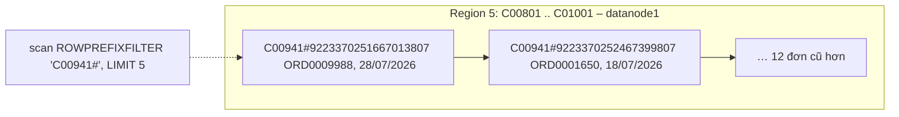

### 3.2.2. Thiết kế bảng HBase

Bảng `btl:customer_orders` phục vụ **truy cập ngẫu nhiên** mà HDFS không đáp ứng được: (1) lấy N đơn mới nhất của một khách; (2) đọc lịch sử trạng thái một đơn; (3) cập nhật trạng thái. Mã nguồn: `src/cau07_hbase/` (Phụ lục B), kết quả ở `output/*.txt`.

**a) RowKey `customer_id#reverse_timestamp`**

- `reverse_timestamp = Long.MAX_VALUE − epoch_ms` (giờ đặt hàng, đủ 19 chữ số), ví dụ `C00941#9223370269063047807`.
- Rowkey sắp theo byte nên đơn của một khách **nằm liền nhau**, **mới nhất đứng đầu**; truy vấn (1) là một lần quét tiền tố với `LIMIT N`.
- Tiền tố là mã khách chứ không phải thời gian nên lượt ghi rải đều các region, tránh *hotspot* [TL:george2011]. Thực tế nên thêm hậu tố `#order_id` phòng trùng mili giây.

*[Hình:c07-rowkey]. Bố trí dòng theo rowkey `customer_id#reverse_timestamp` và truy vấn đơn mới nhất của một khách*

**Nhận xét [Hình:c07-rowkey]:** truy vấn "5 đơn mới nhất của C00941" chỉ chạm một region; kết quả thật (`output/client_api_demo.txt`) trả về ORD0009988, ORD0001650, ORD0008333, ORD0001228, ORD0003359 đúng thứ tự mới đến cũ.

**b) Column family, phiên bản và timestamp**

*[Bảng:c07-column-family]. Ba column family của `btl:customer_orders`*

| CF | Cột (qualifier) | VERSIONS | Lý do tách |
|---|---|---:|---|
| `o` – thông tin đơn | `order_id`, `ts`, `product_id`, `category`, `channel`, `payment`, `province`, … (12 cột) | 1 | Đọc khi hiển thị danh sách; gần như không đổi |
| `m` – tiền | `quantity`, `unit_price`, `discount_rate`, `shipping_fee`, `net_revenue` | 1 | Số liệu tài chính, có thể cấp quyền riêng |
| `d` – giao hàng, phản hồi | `delivery_days`, `returned_flag`, `review_score`, `status` | **5** | Phần duy nhất thay đổi; `status` giữ lịch sử |

Chung cho cả ba CF: `TTL => 94.608.000 giây (3 năm)`, `COMPRESSION => SNAPPY`, `DATA_BLOCK_ENCODING => FAST_DIFF`, `BLOOMFILTER => ROW`. Tên CF một ký tự vì được lặp lại trong mọi ô [TL:george2011].

**Nhận xét [Bảng:c07-column-family]:** mỗi CF là một nhóm HFile riêng, nên cập nhật trạng thái chỉ ghi vào `d` và đọc danh sách đơn không phải qua phiên bản cũ của `status`; ô trống không được ghi (tương đương NULL).

**Timestamp của ô = thời điểm nghiệp vụ**, không phải thời điểm nạp. `d:status` có các phiên bản `PLACED` (lúc đặt), `DELIVERED` (đặt + `delivery_days` ngày) và `RETURNED` (giao + 1 ms). Nhờ vậy `TIMERANGE` trả lời được "trạng thái đơn ORD0013507 ngày 30/09/2025" (PLACED); thêm rồi `delete` phiên bản `REFUNDED` đúng timestamp thì lịch sử quay về 3 phiên bản (kết quả shell ở Phụ lục B).

**c) TTL**

TTL tính theo **timestamp của ô**, nên TTL 3 năm nghĩa là **lưu trực tuyến đơn của 3 năm gần nhất**: đơn tháng 01/2025 tự biến mất từ tháng 01/2028 (xóa hẳn ở major compaction), bản đầy đủ vẫn ở vùng curated. Trên bảng tạm TTL 1 năm, ô có timestamp 10/01/2025 không hiện ra ngay sau `put`.

**d) Pre-splitting**

Bảng được tạo sẵn 6 region với 5 điểm chia `C00201`, `C00401`, `C00601`, `C00801`, `C01001` (mã khách C00001–C01200, mỗi khách 3–26 đơn); kết quả ở `output/load.txt`:

*[Bảng:c07-pre-split]. Phân bố dòng trên 6 region sau khi nạp 14.408 đơn*

| Region (khoảng rowkey) | RegionServer | Số dòng | Số khách |
|---|---|---:|---:|
| (đầu) .. C00201 | datanode2 | 2.384 | 200 |
| C00201 .. C00401 | datanode3 | 2.419 | 200 |
| C00401 .. C00601 | datanode1 | 2.444 | 200 |
| C00601 .. C00801 | datanode2 | 2.377 | 200 |
| C00801 .. C01001 | datanode1 | 2.332 | 200 |
| C01001 .. (cuối) | datanode3 | 2.452 | 200 |
| **Tổng** | | **14.408** | **1.200** |

**Nhận xét [Bảng:c07-pre-split]:**
- Region lớn nhất chỉ hơn region nhỏ nhất 5,1%; mỗi RegionServer giữ đúng 2 region nên tải chia đều cho 3 máy ngay từ đầu, thay vì dồn vào 1 region cho tới khi HBase tự tách.
- Khách mới (C01201 trở đi) rơi vào region cuối; khi region lớn lên, HBase tự tách tiếp.

**e) Nén và mã hóa khối**

*[Bảng:c07-nen]. Dung lượng HFile của cùng 14.408 đơn với hai cấu hình (`output/compression.txt`, 1 bản sao, sau một lần flush)*

| Cấu hình CF | Dung lượng (byte) | So với không nén |
|---|---:|---:|
| Không nén, không mã hóa khối (`NONE`) | 19.950.384 | 100% |
| `SNAPPY` + `FAST_DIFF` (cấu hình chọn) | 3.446.349 | 17,3% (nhỏ hơn 5,79 lần) |
| Tham chiếu: `orders.csv` trên HDFS | 2.298.806 | – |

**Nhận xét [Bảng:c07-nen]:**
- Không nén, HBase gấp 8,7 lần CSV vì mỗi ô lặp lại rowkey, CF, qualifier, timestamp; `FAST_DIFF` chỉ lưu phần khác giữa các khóa liền kề, Snappy nén tiếp, còn gấp 1,5 lần CSV.
- Snappy nén/giải nén nhanh, hợp truy vấn trực tuyến; Bloom filter `ROW` giúp `get` bỏ qua HFile không chứa dòng cần tìm.

**f) Sao lưu**

- **Snapshot** `customer_orders_snap` chỉ ghi danh sách HFile, mất khoảng 1 giây; `clone_snapshot` sang `btl:customer_orders_restore` cho đúng 14.408 dòng.
- `ExportSnapshot` chép sang `/btl/backup/hbase` (3.445.584 byte HFile + 2.180 byte metadata); thực tế nên chép sang cụm khác.
- Đề xuất: snapshot hằng ngày giữ 7 bản, `ExportSnapshot` hằng tuần; vùng raw vẫn là nguồn nạp lại.

**g) Quyền truy cập**

Cụm bật `AccessController`, user `hadoop` là superuser (`output/acl_backup.txt`):

*[Bảng:c07-quyen]. Kiểm tra phân quyền trên `btl:customer_orders`*

| Lệnh | Kết quả |
|---|---|
| `grant 'analyst', 'R', 'btl:customer_orders'` rồi `scan … LIMIT => 2` | Đọc được 2 dòng |
| analyst `put … 'o:order_id', 'HACK'` | `AccessDeniedException … action=WRITE` |
| `revoke 'analyst', 'btl:customer_orders'` rồi `scan` | `AccessDeniedException … action=READ` |

**Nhận xét [Bảng:c07-quyen]:** đề xuất theo vai trò: tiến trình nạp `RW`; ứng dụng chăm sóc khách hàng `R` và `W` riêng trên CF `d`; nhà phân tích `R`; quyền `A` cho quản trị viên. Triển khai thật cần Kerberos để danh tính không giả mạo được [TL:hbase-guide].

**h) Nạp dữ liệu và các thao tác cơ bản**

Bảng được nạp **14.408 đơn sạch** (cùng quy tắc với Spark, Pig, MapReduce) bằng `BufferedMutator` (bộ đệm 4 MB) trong 1,9 giây; `count` bằng shell và Java đều ra 14.408.

*[Bảng:c07-lenh]. Các thao tác create/put/get/scan/delete bằng hbase shell và Java Client API*

| Thao tác | hbase shell (`shell_demo.rb`) | Java Client API (`CustomerOrders.java`) |
|---|---|---|
| create | `create T, {NAME=>'o'}, {NAME=>'m'}, {NAME=>'d', VERSIONS=>5}, SPLITS=>[…]` | `admin.createTable(td, splits)` |
| put | `put T, rowkey, 'd:status', 'REFUNDED', ts` | `Put.addColumn(cf, q, ts, value)`; `BufferedMutator.mutate` |
| get | `get T, rowkey, {COLUMN=>'d:status', VERSIONS=>5}` | `new Get(row).addColumn(D, "status").readVersions(5)` |
| scan | `scan T, {ROWPREFIXFILTER=>'C00941#', LIMIT=>5}` | `new Scan().setStartStopRowForPrefixScan(...).setLimit(n)` |
| delete | `delete T, rowkey, 'd:status', ts`; `deleteall T, rowkey` | `Delete.addColumn(cf, q, ts)` / `new Delete(row)` |

**Nhận xét [Bảng:c07-lenh]:**
- Java dùng cho nạp hàng loạt và ứng dụng, shell cho quản trị; `test.sh` chạy cả hai trên bảng tạm, 14/14 PASS.
- `Delete` chỉ ghi *tombstone* (xóa thật ở major compaction), nên `put` mang timestamp cũ hơn sẽ bị che.
