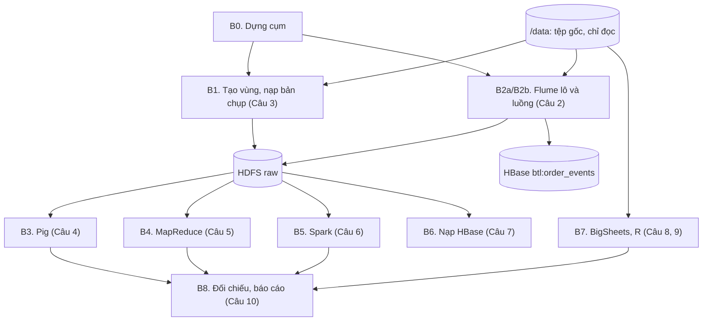
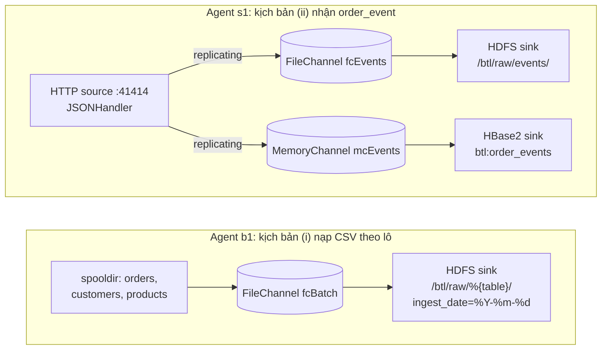

## 3.3. Thiết kế pipeline xử lý

### 3.3.1. Các bước của pipeline

Pipeline chạy trên cụm bốn máy (mục 3.1). [Hình:c03-pipeline] cho thấy thứ tự và quan hệ phụ thuộc giữa các bước; [Bảng:c03-cac-buoc] ghi lệnh và đầu ra của từng bước.

*[Hình:c03-pipeline]. Các bước của pipeline và quan hệ phụ thuộc*

**Nhận xét [Hình:c03-pipeline]:**
- B3–B6 cùng đọc **một** bản chụp raw, không phụ thuộc nhau nên chạy song song được (giới hạn YARN 3 × 2.560 MB).
- Khi vận hành thật, B3–B6 chạy hằng đêm trên partition `ingest_date` của ngày trước, còn B2b chạy liên tục.

*[Bảng:c03-cac-buoc]. Lệnh, đầu vào và đầu ra của từng bước (chạy trong `ssh may1`, thư mục `~/src`)*

| Bước | Lệnh | Đầu ra |
|---|---|---|
| B0 | `start-cluster.sh` | HDFS, YARN, JobHistory, Spark History, HBase |
| B1 | `cau03_hdfs/init_zones.sh` | Bốn vùng, `/btl/raw/<bảng>/ingest_date=2026-08-01/` |
| B2a | `cau02_flume/run_batch.sh` | `/btl/raw/<bảng>/ingest_date=<ngày chạy>/` |
| B2b | `cau02_flume/run_stream.sh` | `/btl/raw/events/ingest_date=<ngày chạy>/`, `btl:order_events` |
| B3 | `cau04_pig/run.sh` | `/btl/staging/orders`, `/btl/output/cau04_pig/` |
| B4 | `cau05_mapreduce/run.sh` | `/btl/output/cau05_mr/` |
| B5 | `cau06_spark/run.sh` | `/btl/curated/orders/…`, `/btl/output/cau06_spark/` |
| B6 | `cau07_hbase/run.sh` | `btl:customer_orders`, `/btl/backup/hbase/` |
| B7 | `cau08_bigsheets/chay.sh`, `cau09_r/chay.sh` (máy `rstudio`) | Dashboard, bảng `kq_*` trong bản sao SQLite |
| B8 | so sánh `compare_category_month.csv` của Câu 4, 5, 6 | Bảng đối chiếu (mục 4.4, 4.5) |

**Nhận xét [Bảng:c03-cac-buoc]:** mỗi bước là **một lệnh** theo đường dẫn đã chốt, tái lập được và chạy lại an toàn (không ghi đè bản chụp, chỉ ghi đè output của chính mình). Phần còn lại trình bày B2 (Câu 2); B1 ở mục 3.2.1, B3–B7 ở mục 2.4, 3.4–3.6.

### 3.3.2. Hai kịch bản Flume

Một agent Flume gồm **Source** (nhận dữ liệu, đóng gói thành *event*), **Channel** (hàng đợi đệm) và **Sink** (ghi ra đích) [TL:flume-guide]. Việc ghi vào và lấy khỏi channel đều nằm trong **giao dịch**: sink chỉ commit khi đã ghi xong, lỗi thì rollback và event trở lại channel.

*[Hình:c02-flume-agent]. Cấu hình Source–Channel–Sink của hai agent Flume*

**Nhận xét [Hình:c02-flume-agent]:**
- `b1` gom ba nguồn vào một FileChannel; interceptor gắn header `table` nên đường dẫn HDFS tự tách theo bảng.
- `s1` chép mỗi event sang hai channel có độ bền khác nhau (mục 3.3.3). Cấu hình đầy đủ ở Phụ lục B (B.1, B.2).

#### a) Kịch bản (i): nạp tệp CSV theo lô vào HDFS

Các tham số chính của agent `b1` và lý do chọn được liệt kê ở [Bảng:c02-tham-so-lo] (Phụ lục B). Raw giữ **nguyên văn** nguồn (không bỏ BOM, tiêu đề); mỗi tệp lô thành một tệp HDFS riêng nên kiểm tra được bằng md5.

*[Bảng:c02-ket-qua-lo]. Kết quả chạy kịch bản (i) (`run_batch.sh`, 11/10/2026)*

| Bảng | Byte tệp gốc | Byte trên HDFS | Dòng | md5 | Replication |
|---|---:|---:|---:|---|---:|
| orders | 2.298.806 | 2.298.806 | 15.001 | trùng khớp | 3 |
| customers | 62.345 | 62.345 | 1.201 | trùng khớp | 3 |
| products | 20.621 | 20.621 | 401 | trùng khớp | 3 |

**Nhận xét [Bảng:c02-ket-qua-lo]:** ba tệp trên HDFS **trùng từng byte** với tệp gốc, không mất dòng nào. Spooldir đọc xong trong **2,06 s**; sink đóng tệp sau **39,1 s** (gồm 30 s `idleTimeout`).

#### b) Kịch bản (ii): nhận `order_event` qua HTTP vào HDFS và HBase

**Cách gửi.** `replay_events.py` (Phụ lục B.3) gửi `events_stream.jsonl` theo lô `POST` đúng định dạng `JSONHandler`, giữ nhịp theo số sự kiện/giây đặt trước. Mỗi lô là một giao dịch nên phải nhỏ hơn `transactionCapacity` (1.000); nhận HTTP 503 hoặc mất kết nối thì chờ tăng dần rồi gửi lại cả lô.

**Bảng HBase `btl:order_events`:** họ cột `e` với 7 cột tách từ JSON bằng `RegexHBase2EventSerializer`, `TTL` 180 ngày. Rowkey `event_id` **lũy đẳng**: gửi lại chỉ ghi đè đúng ô cũ.

*[Bảng:c02-ket-qua-luong]. Kết quả chạy kịch bản (ii)*

| Lần chạy | Sự kiện gửi | Nhịp đặt | Thời gian (s) | Thông lượng (sự kiện/s) | HDFS: dòng / `event_id` khác nhau | HBase: số dòng |
|---|---:|---|---:|---:|---|---:|
| 1. Phát lại toàn bộ | 5.000 | 250/s | 19,805 | 252,5 | 5.000 / 5.000 | 5.000 |
| 2. Gửi lại 1.000 sự kiện đầu | 1.000 | tối đa | 0,048 | 21.031,8 | 6.000 / 5.000 (cộng dồn) | **5.000** |
| Đo thông lượng tối đa | 5.000 | tối đa | 0,61 | 8.199,4 | 5.000 / 5.000 | 5.000 |

**Nhận xét [Bảng:c02-ket-qua-luong]:**
- **Không mất sự kiện, gửi trùng được xử lý đúng:** mỗi channel put và take 6.000 sự kiện, `ChannelSize = 0`. HDFS giữ 6.000 dòng (*ít nhất một lần*), HBase vẫn 5.000 dòng.
- **Thông lượng:** ở 250 sự kiện/s (gần mức đỉnh 230 sự kiện/s, mục 1.3.2) agent theo kịp; gửi không giới hạn đạt khoảng **8.200 sự kiện/s** (chỉ đo trên 5.000 sự kiện, chưa đo tải kéo dài).
- **Hạn chế:** biểu thức chính quy phụ thuộc thứ tự khóa JSON; `event_id` tăng dần nên khi tải lớn mọi lệnh ghi dồn vào một region.

### 3.3.3. MemoryChannel, FileChannel và cơ chế chống mất dữ liệu

*[Bảng:c02-memory-file]. So sánh MemoryChannel và FileChannel*

| Tiêu chí | MemoryChannel | FileChannel |
|---|---|---|
| Nơi giữ event | Heap JVM | Log trên đĩa + checkpoint |
| Khi agent sập | **Mất** event chưa giao | Phát lại log, **không mất** event đã commit |
| Độ trễ, thông lượng | Cao nhất | Thấp hơn vì ghi đĩa mỗi giao dịch |
| Dùng trong đề tài | Nhánh HBase của `s1` (lớp tốc độ) | `b1` và nhánh HDFS của `s1` (lớp lô) |

**Nhận xét [Bảng:c02-memory-file]:** nhánh HDFS là bản ghi gốc nên dùng FileChannel; nhánh HBase cần độ trễ thấp và nếu mất vẫn nạp lại được từ raw (rowkey lũy đẳng không sinh trùng), nên dùng MemoryChannel.

*[Bảng:c02-thi-nghiem-sap]. Thí nghiệm sập agent (`crash_demo.sh`): 1.000 sự kiện nằm trong channel, `kill -9` agent rồi khởi động lại*

| Channel | Sự kiện trong channel lúc sập | Giao xuống HDFS sau khi khởi động lại | `event_id` khác nhau |
|---|---:|---:|---:|
| FileChannel | 1.000 | **1.000** | 1.000 |
| MemoryChannel | 1.000 | **0** | – |

**Nhận xét [Bảng:c02-thi-nghiem-sap]:** agent `c0` không có sink nhận 1.000 sự kiện rồi bị `kill -9`; agent `c1` dùng lại thư mục FileChannel. FileChannel đọc lại đủ 10 giao dịch và giao đủ 1.000 sự kiện; MemoryChannel mất toàn bộ.

**Các cơ chế chống mất dữ liệu:** ngoài giao dịch và FileChannel (checkpoint kép), hệ thống dùng (1) áp lực ngược: channel đầy thì HTTP source trả 503 để client gửi lại; (2) *ít nhất một lần, rồi khử trùng* theo `event_id` ở lớp lô và rowkey lũy đẳng ở HBase [TL:kleppmann2017]. Khi triển khai thật nên thêm nhóm sink `failover` và nhiều agent biên chuyển tiếp qua Avro [TL:flume-guide].
