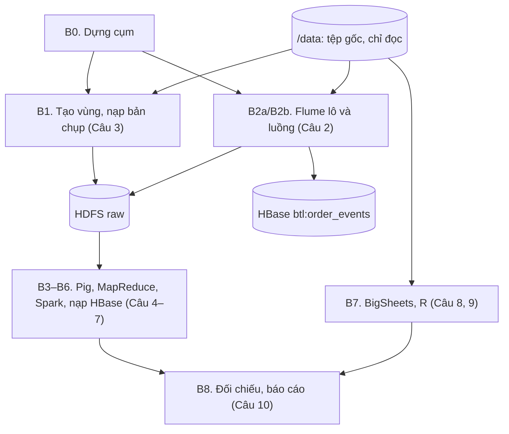
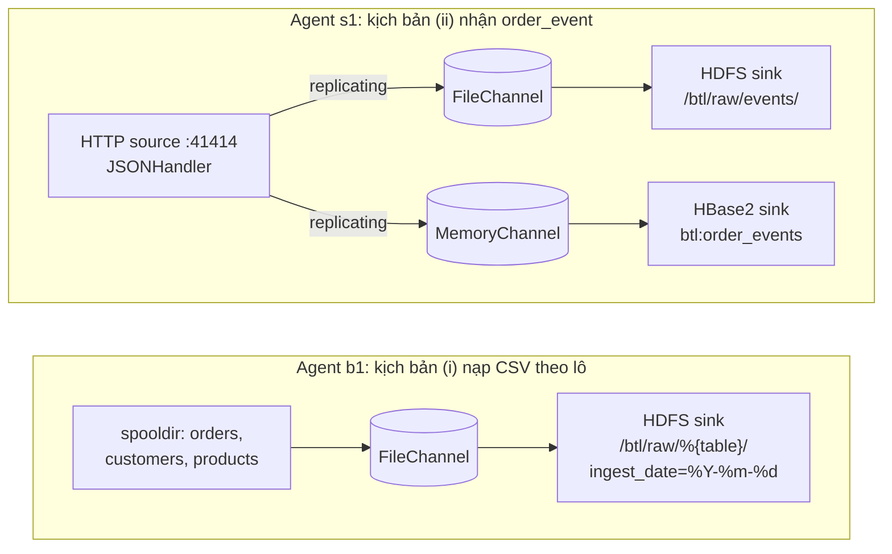

## 3.3. Thiết kế pipeline xử lý

### 3.3.1. Các bước của pipeline

Thứ tự các bước trên cụm (mục 3.1) ở [Hình:c03-pipeline]; lệnh và đầu ra của từng bước ở [Bảng:c03-cac-buoc] (Phụ lục B).

*[Hình:c03-pipeline]. Các bước của pipeline và quan hệ phụ thuộc*

**Nhận xét [Hình:c03-pipeline]:** B3–B6 cùng đọc **một** bản chụp raw, không phụ thuộc nhau nên chạy song song được; mỗi bước là một lệnh, chạy lại an toàn vì chỉ ghi đè output của chính mình. Khi vận hành thật, B3–B6 chạy hằng đêm trên partition của ngày trước, còn B2b chạy liên tục. Phần dưới trình bày B2 (Câu 2); B1 ở mục 3.2.1, B3–B7 ở mục 2.4, 3.4–3.6.

### 3.3.2. Hai kịch bản Flume

Một agent Flume gồm **Source** (nhận dữ liệu thành *event*), **Channel** (hàng đợi đệm) và **Sink** (ghi ra đích) [TL:flume-guide]. Việc ghi vào và lấy khỏi channel nằm trong **giao dịch**: sink chỉ commit khi đã ghi xong, lỗi thì rollback.

*[Hình:c02-flume-agent]. Cấu hình Source–Channel–Sink của hai agent Flume*

**Nhận xét [Hình:c02-flume-agent]:** `b1` gom ba nguồn vào một FileChannel, interceptor gắn header `table` nên đường dẫn HDFS tự tách theo bảng; `s1` chép mỗi event sang hai channel có độ bền khác nhau (mục 3.3.3). Cấu hình đầy đủ ở Phụ lục B (B.1, B.2, [Bảng:c02-tham-so-lo]).

#### a) Kịch bản (i): nạp tệp CSV theo lô vào HDFS

Raw giữ **nguyên văn** nguồn (không bỏ BOM, tiêu đề); mỗi tệp lô thành một tệp HDFS riêng nên kiểm tra được bằng md5. Lần chạy `run_batch.sh` ngày 11/10/2026: ba tệp `orders` (15.001 dòng), `customers` (1.201), `products` (401) trên HDFS **trùng từng byte** với tệp gốc, hệ số nhân bản 3. Spooldir đọc xong trong **2,06 s**; sink đóng tệp sau **39,1 s** (gồm 30 s `idleTimeout`).

#### b) Kịch bản (ii): nhận `order_event` qua HTTP vào HDFS và HBase

`replay_events.py` (Phụ lục B.3) gửi `events_stream.jsonl` theo lô `POST`, giữ nhịp đặt trước; mỗi lô là một giao dịch nên nhỏ hơn `transactionCapacity` (1.000), nhận HTTP 503 thì chờ tăng dần rồi gửi lại cả lô. Bảng `btl:order_events` có họ cột `e` (7 cột tách từ JSON bằng `RegexHBase2EventSerializer`), `TTL` 180 ngày, rowkey `event_id` **lũy đẳng**: gửi lại chỉ ghi đè đúng ô cũ.

*[Bảng:c02-ket-qua-luong]. Kết quả chạy kịch bản (ii)*

| Lần chạy | Sự kiện | Thời gian (s) | Sự kiện/s | HDFS: dòng / `event_id` khác nhau | HBase: dòng |
|---|---:|---:|---:|---|---:|
| 1. Phát lại, nhịp 250/s | 5.000 | 19,805 | 252,5 | 5.000 / 5.000 | 5.000 |
| 2. Gửi lại 1.000 sự kiện đầu | 1.000 | 0,048 | 21.031,8 | 6.000 / 5.000 | **5.000** |
| Đo tối đa | 5.000 | 0,61 | 8.199,4 | 5.000 / 5.000 | 5.000 |

**Nhận xét [Bảng:c02-ket-qua-luong]:** không mất sự kiện (`ChannelSize = 0`); HDFS giữ 6.000 dòng (*ít nhất một lần*), HBase vẫn 5.000 dòng. Ở 250 sự kiện/s (gần đỉnh 230 sự kiện/s, mục 1.3.2) agent theo kịp, tối đa khoảng **8.200 sự kiện/s**. Hạn chế: biểu thức chính quy phụ thuộc thứ tự khóa JSON, và `event_id` tăng dần nên khi tải lớn mọi lệnh ghi dồn vào một region.

### 3.3.3. MemoryChannel, FileChannel và cơ chế chống mất dữ liệu

*[Bảng:c02-memory-file]. So sánh MemoryChannel và FileChannel*

| Tiêu chí | MemoryChannel | FileChannel |
|---|---|---|
| Nơi giữ event | Heap JVM, nhanh nhất | Log trên đĩa + checkpoint |
| Thí nghiệm sập: 1.000 sự kiện trong channel, `kill -9` | **0** sự kiện giao lại | **1.000** sự kiện giao lại |
| Dùng trong đề tài | Nhánh HBase của `s1` | `b1` và nhánh HDFS của `s1` |

**Nhận xét [Bảng:c02-memory-file]:** trong `crash_demo.sh`, agent dùng lại thư mục FileChannel đọc lại đủ 10 giao dịch, còn MemoryChannel mất toàn bộ. Vì vậy nhánh HDFS (bản ghi gốc) dùng FileChannel; nhánh HBase cần độ trễ thấp và nếu mất vẫn nạp lại được từ raw, nên dùng MemoryChannel.

**Các cơ chế chống mất dữ liệu:** ngoài giao dịch và FileChannel (checkpoint kép), hệ thống dùng (1) áp lực ngược: channel đầy thì HTTP source trả 503 để client gửi lại; (2) *ít nhất một lần, rồi khử trùng* theo `event_id` ở lớp lô và rowkey lũy đẳng ở HBase [TL:kleppmann2017]. Triển khai thật nên thêm nhóm sink `failover` và nhiều agent biên chuyển tiếp qua Avro [TL:flume-guide].
