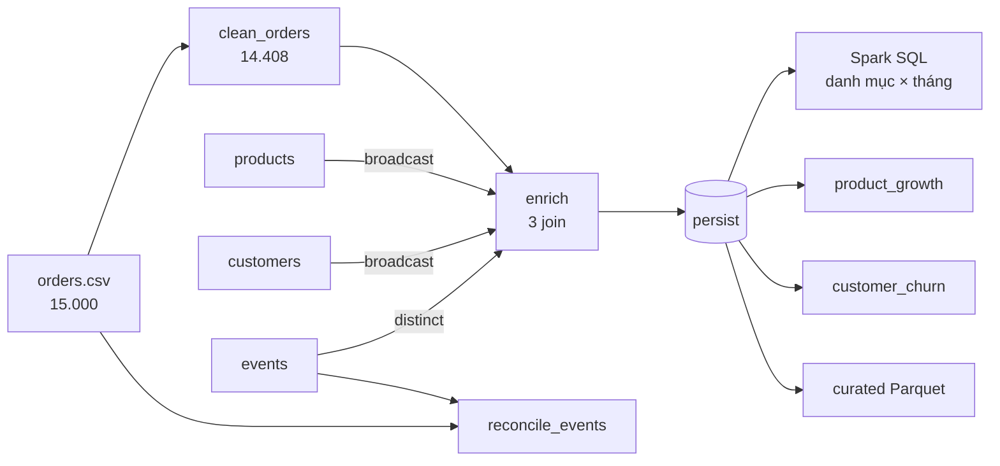

## 3.4. Cài đặt xử lý bằng Spark/PySpark

Câu 6 là một chương trình PySpark (`src/cau06_spark/pipeline.py`) chạy trên YARN bằng `spark-submit` (2 executor × 1 GB, `spark.sql.shuffle.partitions = 12`). Chương trình dùng **DataFrame** và **Spark SQL**, không dùng RDD hay UDF Python, để Catalyst tự tối ưu kế hoạch và tránh tuần tự hóa từng dòng giữa JVM và Python [TL:armbrust2015].

### 3.4.1. Luồng xử lý



*[Hình:c06-dag-pipeline]. Luồng DataFrame của pipeline Câu 6*

**Nhận xét [Hình:c06-dag-pipeline]:** DataFrame `enriched` là điểm rẽ nhánh của bốn nhánh phân tích và nhánh ghi curated, nên là chỗ duy nhất được `persist`. Nhánh `reconcile_events` cố ý dùng **15.000 đơn chưa làm sạch** để biết sự kiện nào ứng với đơn bị loại.

### 3.4.2. Transformations, actions và cache

*[Bảng:c06-transformations]. Các transformation dùng trong pipeline (đánh dấu `T1`…`T7` trong mã)*

| # | Transformation | Dùng ở đâu | Vai trò |
|---|---|---|---|
| T1 | `filter` | `clean_orders` | Bỏ OUTLIER/DUPLICATE/LATE |
| T2 | `withColumn` (`to_timestamp`, `date_format`, `when`…) | `clean_orders`, `enrich` | Chốt kiểu, ô trống → NULL, tạo 24 cột mới |
| T3 | `join` + `broadcast` (kiểu `left`) | `enrich`, `reconcile_events` | Ghép danh mục, cờ `seen_in_stream` |
| T4 | `groupBy().agg()` (`sum`, `count`, `covar_pop`, `var_pop`…) | tăng trưởng, rời bỏ, đối chiếu | Tổng hợp theo sản phẩm × tháng, khách hàng |
| T5 | `crossJoin` | `product_growth` | Lưới 400 sản phẩm × 19 tháng, tháng không bán tính là 0 |
| T6 | Hàm cửa sổ `row_number`, `ntile(5)` | `product_growth`, `customer_churn` | Xếp hạng trong danh mục; điểm R, F, M |
| T7 | `repartition(year, month, category)` | ghi curated | Mỗi phân vùng 1 tệp Parquet |
| – | `select`, `distinct`, `fillna`, `orderBy`, `union`, `pivot` | nhiều nơi | Phụ trợ |

*[Bảng:c06-actions]. Các action và nhóm job Spark chúng sinh ra*

| # | Action | Kết quả |
|---|---|---|
| A1 | `enriched.count()` | 14.408 đơn; **vật chất hóa cache** |
| A2 | `agg(...).first()` | Doanh thu 78.218.341,22, 1.114 đơn trả, 0 đơn join hụt |
| A3 | `spark.sql(...).collect()` | 114 dòng danh mục × tháng |
| A4 | `product_growth(...).collect()` | 400 sản phẩm |
| A5 | `customer_churn(...).collect()` | 1.200 khách với mức nguy cơ |
| A6 | `reconcile_events(...).collect()` | Đối chiếu 5.000 sự kiện |
| A7 | `orders_raw.count()`, `show()` | Số dòng raw, ví dụ trước/sau |
| A8 | `write.parquet(...)`, `write.csv(...)` | Vùng curated và 5 kết quả |
| A9 | `spark.read.parquet(curated).count()` | Đọc lại 14.408 dòng |

**Nhận xét [Bảng:c06-transformations] và [Bảng:c06-actions]:**
- 7 nhóm transformation và 9 action, vượt yêu cầu "ít nhất năm transformations và ba actions". Phần phân tích (A1–A6) sinh **11 job, 23 stage, 126 task** (`pipeline_metrics.json`).
- `collect()` chỉ dùng cho kết quả đã tổng hợp (tối đa 1.200 dòng).

**Cache/persist.** `enriched` được `persist(StorageLevel.MEMORY_AND_DISK)` sau join, vật chất hóa bởi A1, dùng lại cho A2–A5, A8, rồi `unpersist()` sau khi ghi xong. Lý do:
- Không cache thì mỗi action đọc lại `orders.csv` và làm lại ba join; mục 4.4 đo được dữ liệu đọc tăng từ 7,06 MB lên 16,18 MB, số stage từ 23 lên 29.
- `MEMORY_AND_DISK` thay vì `MEMORY_ONLY` vì executor chỉ có 1 GB: thiếu bộ nhớ thì phân vùng xuống đĩa thay vì bị tính lại.
- Không cache hai danh mục (đã broadcast) và `orders_raw` (chỉ dùng hai lần).

### 3.4.3. Join, groupBy và Spark SQL

- **Join:** cả ba join ở `enrich` là **broadcast hash join** (`explain` cho `BroadcastHashJoin LeftOuter BuildRight`), bảng đơn hàng không phải shuffle.
- **Spark SQL:** bảng danh mục × tháng viết bằng SQL trên temp view `orders_clean`, cộng tiền ở `DECIMAL(14,2)` nên khớp từng byte với MapReduce và Pig (mục 4.5).

```sql
SELECT category, ym AS month, COUNT(*) AS orders,
       CAST(SUM(CAST(net_revenue AS DECIMAL(14,2))) AS DECIMAL(16,2)) AS net_revenue,
       SUM(returned_flag) AS returned,
       ROUND(100.0 * SUM(returned_flag) / COUNT(*), 2) AS return_rate_pct
FROM orders_clean GROUP BY category, ym ORDER BY category, month
```

- **groupBy – sản phẩm tăng trưởng nhanh:** gộp theo `product_id × month_idx`, so cửa sổ **R** (05–07/2026) với **P** (02–04/2026):
  - `growth_rev_pct = (rev_R − rev_P) / rev_P × 100`, tương tự cho số lượng;
  - độ dốc 19 tháng `slope = covar_pop(month_idx, rev) / var_pop(month_idx)`;
  - `z_orders = (n_R − n_P) / √(n_R + n_P)` (hiệu hai biến Poisson; |z| ≥ 1,96 là khó do ngẫu nhiên);
  - **tăng trưởng nhanh** khi mỗi cửa sổ có ít nhất 3 đơn, doanh thu **và** số lượng cùng tăng ≥ 50%, độ dốc dương.
- **groupBy – khách có nguy cơ rời bỏ** (mốc 31/07/2026):
  - `recency_days`, `frequency`, `monetary`, `avg_gap_days`; số đơn 6 tháng cuối so với 6 tháng trước; điểm R, F, M bằng `ntile(5)`;
  - **HIGH**: không mua quá 90 ngày **và** số đơn 6 tháng cuối giảm; **MEDIUM**: quá 90 ngày, hoặc quá max(60, 2 × `avg_gap_days`) ngày, hoặc số đơn giảm ít nhất một nửa (từ ≥ 4 đơn); còn lại **LOW**;
  - đường cơ sở Poisson: số khách *ngẫu nhiên* không mua trong 90 ngày là Σ exp(−90 × `frequency` / 577).

Kết quả và diễn giải ở mục 4.2.2; cách lưu kết quả ở mục 3.6.
