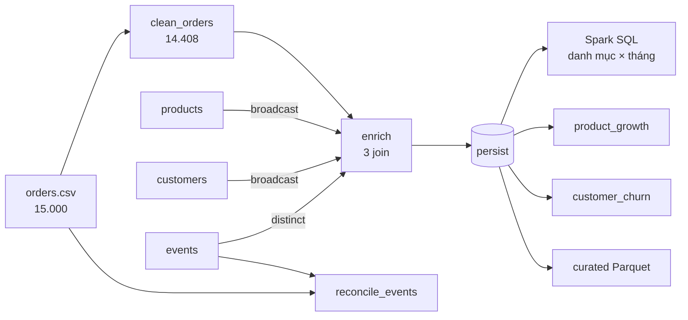

## 3.4. Cài đặt xử lý bằng Spark/PySpark

Câu 6 là một chương trình PySpark (`src/cau06_spark/pipeline.py`) chạy trên YARN bằng `spark-submit` (`spark.sql.shuffle.partitions = 12`). Chỉ dùng **DataFrame** và **Spark SQL** (không RDD, không UDF Python) để Catalyst tự tối ưu và tránh tuần tự hóa từng dòng giữa JVM và Python [TL:armbrust2015].

### 3.4.1. Luồng xử lý

*[Hình:c06-dag-pipeline]. Luồng DataFrame của pipeline Câu 6*

**Nhận xét [Hình:c06-dag-pipeline]:** `enriched` là điểm rẽ nhánh duy nhất nên được `persist`; `reconcile_events` cố ý dùng **15.000 đơn chưa làm sạch** để biết sự kiện nào ứng với đơn bị loại.

### 3.4.2. Transformations, actions và cache

*[Bảng:c06-transformations]. Các transformation dùng trong pipeline (đánh dấu `T1`…`T7` trong mã)*

| # | Transformation | Vai trò |
|---|---|---|
| T1 | `filter` | Bỏ OUTLIER/DUPLICATE/LATE (`clean_orders`) |
| T2 | `withColumn` (`to_timestamp`, `when`…) | Chốt kiểu, ô trống → NULL, tạo 24 cột mới |
| T3 | `join` + `broadcast` (kiểu `left`) | Ghép danh mục, cờ `seen_in_stream` (`enrich`) |
| T4 | `groupBy().agg()` (`sum`, `covar_pop`…) | Tổng hợp theo sản phẩm × tháng, khách hàng |
| T5 | `crossJoin` | Lưới 400 sản phẩm × 19 tháng, tháng không bán tính là 0 |
| T6 | Hàm cửa sổ `row_number`, `ntile(5)` | Xếp hạng trong danh mục; điểm R, F, M |
| T7 | `repartition(year, month, category)` | Mỗi phân vùng curated 1 tệp Parquet |

*[Bảng:c06-actions]. Các action và nhóm job Spark chúng sinh ra*

| # | Action | Kết quả |
|---|---|---|
| A1 | `enriched.count()` | 14.408 đơn; **vật chất hóa cache** |
| A2 | `agg(...).first()` | Doanh thu 78.218.341,22, 1.114 đơn trả, 0 đơn join hụt |
| A3–A6 | `collect()` của SQL danh mục × tháng, `product_growth`, `customer_churn`, `reconcile_events` | 114 dòng; 400 sản phẩm; 1.200 khách; 5.000 sự kiện |
| A7, A9 | `orders_raw.count()`, `show()`; đọc lại curated `count()` | Số dòng raw, ví dụ trước/sau; 14.408 dòng |
| A8 | `write.parquet(...)`, `write.csv(...)` | Vùng curated và 5 kết quả |

**Nhận xét [Bảng:c06-transformations] và [Bảng:c06-actions]:** 7 nhóm transformation và 9 action, vượt yêu cầu "ít nhất năm transformations và ba actions"; phần phân tích (A1–A6) sinh **11 job, 23 stage, 126 task**.

**Cache/persist.** `enriched` được `persist(StorageLevel.MEMORY_AND_DISK)` sau join, vật chất hóa bởi A1, dùng lại cho A2–A5, A8, rồi `unpersist()`. Không cache thì mỗi action đọc lại `orders.csv` và làm lại ba join: dữ liệu đọc tăng từ 7,06 MB lên 16,18 MB, số stage từ 23 lên 29 (mục 4.4). Chọn `MEMORY_AND_DISK` vì executor chỉ có 1 GB: thiếu bộ nhớ thì phân vùng xuống đĩa thay vì bị tính lại. Hai danh mục (đã broadcast) và `orders_raw` (chỉ dùng hai lần) không được cache.

### 3.4.3. Join, groupBy và Spark SQL

- **Join:** cả ba join ở `enrich` là **broadcast hash join**, bảng đơn hàng không phải shuffle.
- **Spark SQL:** bảng danh mục × tháng viết bằng SQL trên temp view `orders_clean`, cộng tiền ở `DECIMAL(14,2)` nên khớp từng byte với MapReduce và Pig (mục 4.5; câu lệnh ở Phụ lục B).
- **Sản phẩm tăng trưởng nhanh:** so cửa sổ **R** (05–07/2026) với **P** (02–04/2026); đạt khi mỗi cửa sổ có ít nhất 3 đơn, doanh thu **và** số lượng cùng tăng ≥ 50%, độ dốc 19 tháng dương.
- **Khách có nguy cơ rời bỏ** (mốc 31/07/2026): **HIGH** khi không mua quá 90 ngày **và** số đơn 6 tháng cuối giảm; **MEDIUM** khi quá 90 ngày, hoặc quá nhịp mua thường lệ, hoặc số đơn giảm ít nhất một nửa; còn lại **LOW**.

Công thức đầy đủ (`z_orders`, RFM, đường cơ sở Poisson) ở Phụ lục B; kết quả ở mục 4.2.2.
