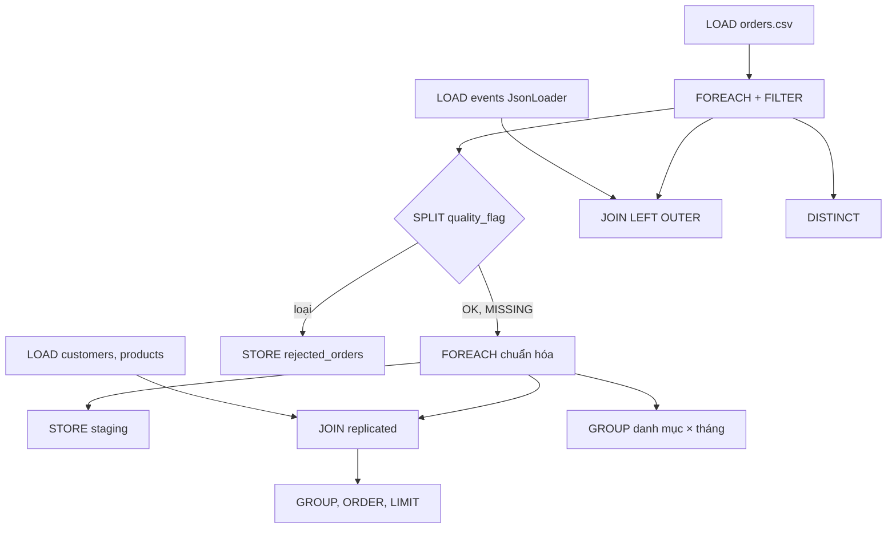
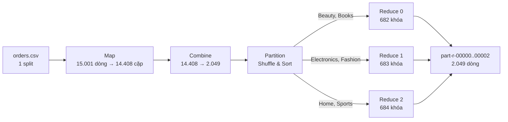

## 3.5. Thuật toán/chức năng chuyên biệt

Mục này trình bày kịch bản Pig Latin (Câu 4), thuật toán MapReduce (Câu 5) và mã HBase Client API (Câu 7). Mã nguồn nằm ở `src/cau04_pig/`, `src/cau05_mapreduce/`, `src/cau07_hbase/`; đoạn mã chính ở Phụ lục B.

### 3.5.1. Kịch bản Pig Latin (Câu 4)

**Cách hiểu đề.** Đề yêu cầu "JOIN bảng sự kiện với hai bảng danh mục", nhưng `events_stream.jsonl` không có `customer_id`, `product_id` ([Bảng:thuoc-tinh-events]). Vì vậy:
- **Bảng sự kiện** là bảng sự thật `orders` (`fact_main`): mỗi dòng là một sự kiện đặt hàng, có đủ khóa ngoại để JOIN với `customers`, `products`.
- **Sự kiện JSON** vẫn được LOAD bằng `JsonLoader` (schema lồng nhau) và JOIN với `orders` theo mã đơn để kiểm tra nhất quán, không cộng vào doanh thu vì trùng với đơn gốc (quy ước §2).

Kịch bản `cau04.pig` (254 dòng) chạy ở chế độ `mapreduce` trên bản chụp `ingest_date=2026-08-01` (`bash src/cau04_pig/run.sh`), luồng dữ liệu như [Hình:c04-luong-pig].

*[Hình:c04-luong-pig]. Luồng dữ liệu của kịch bản Pig Câu 4*

**Nhận xét [Hình:c04-luong-pig]:** Kịch bản có ba nhánh: **làm sạch** (ra staging, mục 2.4.1), **làm giàu và tổng hợp** trên đơn sạch, **kiểm tra chất lượng** (đối chiếu sự kiện, DISTINCT). Các nhánh dùng chung kết quả FILTER/SPLIT nên nhờ *multi-query execution*, Pig đọc `orders.csv` một lần cho nhiều STORE [TL:pig-docs].

**Toán tử và hàm.** Kịch bản dùng đủ 10 nhóm toán tử đề yêu cầu (LOAD, FILTER, SPLIT, FOREACH, JOIN, GROUP, DISTINCT, ORDER, LIMIT, STORE), thêm UNION và FLATTEN, cùng 12 hàm dựng sẵn; vị trí từng toán tử, hàm trong mã ở [Bảng:c04-toan-tu] và [Bảng:c04-ham] (Phụ lục B). Ba quyết định thiết kế chính:
- **Replicated join:** `customers` (1.200 dòng) và `products` (400 dòng) được nạp vào bộ nhớ từng map task, JOIN ngay ở pha Map, không shuffle bảng đơn hàng [TL:pig-docs].
- **Đếm tiền bằng xu:** doanh thu đổi sang số nguyên xu (`ROUND(net_revenue * 100.0)`) trước khi SUM, nên tổng chính xác tuyệt đối và khớp từng xu với MapReduce.
- **ORDER lồng cho kết quả nhỏ:** các kết quả 6–114 dòng được sắp bằng ORDER lồng trong `GROUP … ALL`; ORDER cấp quan hệ (cần thêm job lấy mẫu) chỉ giữ cho top 10 sản phẩm. Số job MapReduce giảm từ **26** xuống **17** (`output/version_history.txt`).

**Kiểm thử Câu 4.** `test.sh` chạy chính kịch bản ở chế độ `pig -x local` trên 25 dòng mẫu (tự thêm BOM, CRLF), rồi kiểm tra kết quả thật trong `output/`.

*[Bảng:c04-kiem-thu]. Trường hợp kiểm thử của Câu 4 (`bash test.sh`, khoảng 12 giây)*

| # | Trường hợp | Dữ liệu vào | Kết quả mong đợi | Kết quả |
|---|---|---|---|---|
| TC1 | Lọc, tách bản ghi | 1 tiêu đề BOM; 2 dòng hỏng; 18 OK, 1 MISSING, 1 OUTLIER, 1 DUPLICATE, 1 LATE | HEADER 1, INVALID 2; giữ 19, loại 3; lệch danh mục 0 | PASS |
| TC2 | Tệp đối chiếu | 19 đơn sạch | Đúng 7 dòng; `Books,2025-01` = 3100.30, 50.00%; 2/3 → 66.67 | PASS |
| TC3 | Vùng staging | như trên | 19 dòng × 24 cột; không còn BOM/CR; `review_score` NULL, `campaign_id = NONE` | PASS |
| TC4 | Sự kiện JSON | 5 sự kiện | Phát hiện đúng 1 sự kiện lệch, 1 sự kiện không có đơn | PASS |
| TC5 | Kết quả thật | `compare_category_month.csv` | 114 ô; tổng 14.408 đơn, 78.218.341,22, 1.114 đơn trả | PASS |
| TC6 | Đối chiếu MapReduce | tệp Câu 4 và Câu 5 | Giống hệt từng byte (`diff`) | PASS |

**Nhận xét [Bảng:c04-kiem-thu]:** TC1–TC4 kiểm tra logic trên dữ liệu mẫu có ca biên tính tay (dòng hỏng, ô trống, sự kiện mồ côi); TC5–TC6 kiểm tra kết quả thật, báo lỗi nếu sửa kịch bản mà quên chạy lại `run.sh`.

### 3.5.2. Thuật toán MapReduce (Câu 5)

**Bài toán.** Với mỗi bộ (danh mục, tỉnh giao hàng, tháng), tính số đơn sạch, tổng `net_revenue`, số đơn trả và tỷ lệ trả = 100 × số đơn trả / số đơn (làm tròn 2 chữ số). Đầu vào là tệp raw `orders.csv` (còn BOM, tiêu đề, CRLF); đầu ra ở `/btl/output/cau05_mr/category_province_month/`. Chương trình gồm 7 tệp Java trong gói `btl.cau05` (6 lớp và 1 enum Counter).

*[Hình:c05-luong-mr]. Luồng dữ liệu của job MapReduce Câu 5 (số liệu từ counter của lần chạy thật)*

**Nhận xét [Hình:c05-luong-mr]:** Tệp 2,3 MB nhỏ hơn một block (128 MB) nên chỉ có **1 split, 1 map task**; Combiner vì thế gộp mỗi khóa còn đúng một bản ghi (2.049). Ba reducer nhận 682/683/684 khóa, tải gần như bằng nhau.

*[Bảng:c05-kieu-kv]. Cặp khóa–giá trị vào/ra của từng bước*

| Bước | Khóa vào | Giá trị vào | Khóa ra | Giá trị ra | Xử lý |
|---|---|---|---|---|---|
| Mapper | `LongWritable` (vị trí byte) | `Text` (một dòng CSV) | `Text` `category⇥province⇥month` | `OrderStats(1, xu, returned_flag)` | Bỏ BOM, tiêu đề, dòng hỏng, OUTLIER/DUPLICATE/LATE; đổi `net_revenue` sang xu; tăng Counter |
| Combiner | `Text` | danh sách `OrderStats` | `Text` | `OrderStats` (tổng một phần) | Cộng 3 thành phần; không chia |
| Partitioner | `Text`, `OrderStats` | — | số reducer 0–2 | — | Lấy `category`, tra bảng ánh xạ |
| Reducer | `Text` | danh sách `OrderStats` | `Text` | `Text` `orders⇥net_revenue⇥returned⇥return_rate_pct` | Cộng dồn rồi mới tính tỷ lệ (HALF_UP bằng số nguyên) |

**Nhận xét [Bảng:c05-kieu-kv]:**
- **Khóa** là `Text` ghép bằng tab thay cho lớp `WritableComparable` riêng: `Text` có sẵn bộ so sánh trên byte (*raw comparator*) [TL:white2015]; tab (0x09) nhỏ hơn mọi ký tự in được nên thứ tự byte trùng thứ tự danh mục → tỉnh → tháng; `TextOutputFormat` ghi thẳng ra dòng TSV.
- **Giá trị** `OrderStats` gồm 3 số `long`, đều là tổng có tính giao hoán và kết hợp, nên Combiner gọi 0, 1 hay nhiều lần đều cho cùng kết quả [TL:dean2004]. Tỷ lệ trả **không** tính ở Combiner vì trung bình các tỷ lệ cục bộ khác tỷ lệ chung; Combiner là lớp riêng vì đầu ra Reducer (`Text`) khác kiểu đầu ra Mapper.
- **Tiền tính bằng xu** (số nguyên) nên phép cộng chính xác, trùng từng xu với Pig và với oracle Python dùng `Decimal`.

Ví dụ lần theo khóa `Beauty⇥Can Tho⇥2026-04` qua từng bước với dữ liệu thật ở [Bảng:c05-vi-du] (Phụ lục B).

**Shuffle & Sort.** Mỗi cặp ra khỏi Map/Combine được ghi vào vùng đệm, gán số phân vùng, sắp theo khóa rồi tràn (*spill*) xuống đĩa cục bộ. Mỗi reducer kéo đúng phân vùng của mình, trộn (*merge*) các đoạn đã sắp, rồi gọi `reduce` một lần cho mỗi khóa với toàn bộ giá trị của khóa đó [TL:white2015], [TL:hadoop-mr-tutorial]. Với 1 map task, counter ghi `SHUFFLED_MAPS = 3` và `MERGED_MAP_OUTPUTS = 3`.

**Partitioner.** `CategoryPartitioner` chia theo **danh mục** nên mỗi tệp `part-r-0000x` chứa trọn số liệu của một số danh mục. Bảng ánh xạ chia theo khoảng chữ cái (Beauty, Books → 0; Electronics, Fashion → 1; Home, Sports → 2), nên nối `part-r-00000..00002` được thứ tự toàn cục, giống `TotalOrderPartitioner`. Trên số liệu thật, cách này lệch tải 1,077 (max/TB); băm `hash(category) mod 3` lệch 2,143 vì **reducer 2 không nhận gì**, còn `HashPartitioner` trên cả khóa cân bằng hơn (1,014) nhưng rải mỗi danh mục ra cả 3 tệp ([Bảng:c05-phan-vung], Phụ lục B).

**Kiểm thử Câu 5.** `test.sh` biên dịch lại rồi chạy chính các lớp trên ở chế độ local (không cần HDFS/YARN) với 25 dòng mẫu; kết quả mong đợi tính tay nằm trong `tests/expected/`.

*[Bảng:c05-kiem-thu]. Trường hợp kiểm thử của Câu 5 (`bash test.sh`, khoảng 16 giây)*

| # | Trường hợp | Kiểm tra | Kết quả mong đợi | Kết quả |
|---|---|---|---|---|
| TC1 | Đọc và làm sạch | Counter của Mapper | `HEADER_SKIPPED=1`, `MALFORMED=2`, `DROP_OUTLIER/DUPLICATE/LATE=1/1/1`, `KEPT_OK=18`, `KEPT_MISSING=1` | PASS |
| TC2 | Combiner | Bật/tắt Combiner | Hai đầu ra giống hệt; bật: combine vào 19, ra 8 | PASS |
| TC3 | Partitioner | Nội dung từng `part-r-*` | r0 = {Beauty, Books}, r1 = {Electronics, Fashion}, r2 = {Home, Sports} | PASS |
| TC4 | Gộp danh mục × tháng, làm tròn | `-D cau05.level=category_month` | `Books 2025-01`: 3100.30, 50.00%; 2/3 → 66.67; 0.01 + 1000.10 + 2000.20 = 3000.31 | PASS |
| TC5 | Dữ liệu thật | So với oracle Python (`tests/oracle.py`) | Trùng từng byte; tổng 14.408 đơn, 78.218.341,22, 1.114 đơn trả | PASS |

**Nhận xét [Bảng:c05-kiem-thu]:** Đề yêu cầu ít nhất ba trường hợp; bộ test có năm. TC2, TC3 kiểm tra hai thành phần dễ sai nhất; TC5 đối chiếu với một cài đặt độc lập không chung mã với Java.

### 3.5.3. HBase Client API (Câu 7)

Chức năng truy cập ngẫu nhiên theo khách hàng được cài đặt bằng Java Client API của HBase (`src/cau07_hbase/CustomerOrders.java`), bên cạnh kịch bản `hbase shell`. Thiết kế bảng, rowkey `customer_id#reverse_timestamp` và các thao tác create/put/get/scan/delete được trình bày ở mục 3.2.2 ([Bảng:c07-lenh]); đoạn mã chính nằm ở Phụ lục B.
