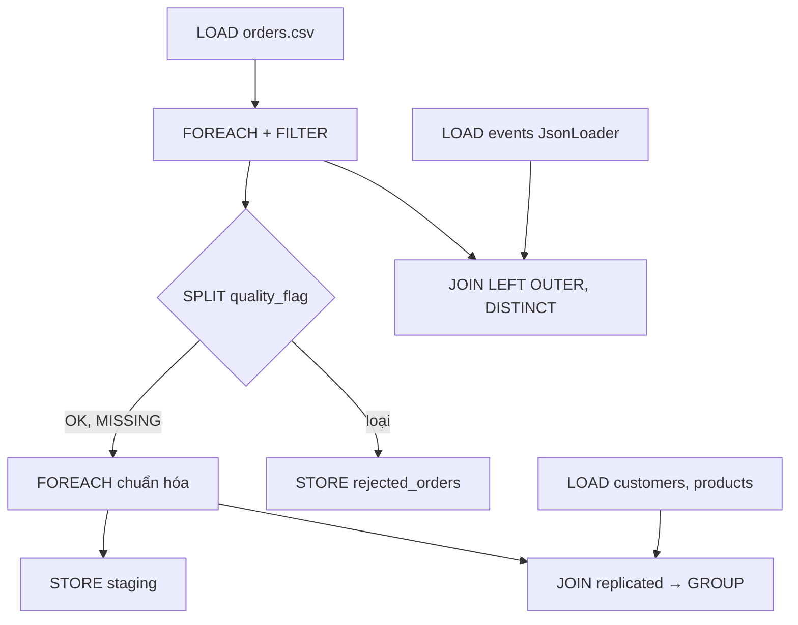
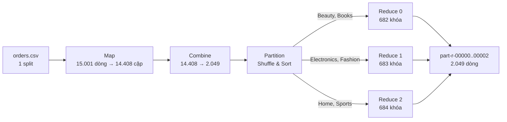

## 3.5. Thuật toán/chức năng chuyên biệt

Mục này trình bày kịch bản Pig Latin (Câu 4), thuật toán MapReduce (Câu 5) và mã HBase Client API (Câu 7); mã nguồn ở `src/cau04_pig/`, `src/cau05_mapreduce/`, `src/cau07_hbase/`, đoạn mã chính ở Phụ lục B.

### 3.5.1. Kịch bản Pig Latin (Câu 4)

**Cách hiểu đề.** `events_stream.jsonl` không có `customer_id`, `product_id` ([Bảng:thuoc-tinh-events]) nên "bảng sự kiện" được hiểu là bảng sự thật `orders`, JOIN với `customers`, `products`. Sự kiện JSON vẫn được LOAD bằng `JsonLoader` và JOIN với `orders` theo mã đơn để kiểm tra nhất quán, không cộng vào doanh thu (quy ước §2). Kịch bản `cau04.pig` (254 dòng) chạy ở chế độ `mapreduce` (`bash src/cau04_pig/run.sh`).

*[Hình:c04-luong-pig]. Luồng dữ liệu của kịch bản Pig Câu 4*

**Nhận xét [Hình:c04-luong-pig]:** Ba nhánh **làm sạch** (mục 2.4.1), **làm giàu và tổng hợp**, **kiểm tra chất lượng** dùng chung kết quả FILTER/SPLIT, nên nhờ *multi-query execution* Pig chỉ đọc `orders.csv` một lần [TL:pig-docs].

**Toán tử, hàm và thiết kế.** Kịch bản dùng đủ 10 nhóm toán tử đề yêu cầu, thêm UNION, FLATTEN và 12 hàm dựng sẵn ([Bảng:c04-toan-tu], [Bảng:c04-ham], Phụ lục B). `customers` (1.200 dòng) và `products` (400 dòng) được **replicated join** ở pha Map, không shuffle bảng đơn hàng. Doanh thu được đổi sang **số nguyên xu** trước khi SUM nên khớp từng xu với MapReduce. Kết quả nhỏ dùng ORDER lồng trong `GROUP … ALL` thay cho ORDER cấp quan hệ, giảm số job từ **26** xuống **17** (`output/version_history.txt`).

**Kiểm thử Câu 4.** `test.sh` chạy chính kịch bản bằng `pig -x local` trên 25 dòng mẫu rồi kiểm tra kết quả thật; cả 6 trường hợp đều PASS, gồm đối chiếu với tệp của Câu 5 giống hệt từng byte ([Bảng:c04-kiem-thu], Phụ lục B).

### 3.5.2. Thuật toán MapReduce (Câu 5)

**Bài toán.** Với mỗi bộ (danh mục, tỉnh giao hàng, tháng), tính số đơn sạch, tổng `net_revenue`, số đơn trả và tỷ lệ trả = 100 × số đơn trả / số đơn (làm tròn 2 chữ số). Đầu vào là tệp raw `orders.csv` (còn BOM, tiêu đề, CRLF).

*[Hình:c05-luong-mr]. Luồng dữ liệu của job MapReduce Câu 5 (số liệu từ counter của lần chạy thật)*

**Nhận xét [Hình:c05-luong-mr]:** Tệp 2,3 MB nhỏ hơn một block nên chỉ có **1 map task**; Combiner gộp mỗi khóa còn đúng một bản ghi (2.049), ba reducer nhận tải gần bằng nhau.

*[Bảng:c05-kieu-kv]. Cặp khóa–giá trị vào/ra của từng bước*

| Bước | Khóa vào | Giá trị vào | Khóa ra | Giá trị ra | Xử lý |
|---|---|---|---|---|---|
| Mapper | `LongWritable` (vị trí byte) | `Text` (một dòng CSV) | `Text` `category⇥province⇥month` | `OrderStats(1, xu, returned_flag)` | Bỏ BOM, tiêu đề, dòng hỏng, OUTLIER/DUPLICATE/LATE; tăng Counter |
| Combiner | `Text` | danh sách `OrderStats` | `Text` | `OrderStats` (tổng một phần) | Cộng 3 thành phần |
| Partitioner | `Text`, `OrderStats` | — | số reducer 0–2 | — | Tra bảng ánh xạ theo `category` |
| Reducer | `Text` | danh sách `OrderStats` | `Text` | `Text` `orders⇥net_revenue⇥returned⇥return_rate_pct` | Cộng dồn rồi tính tỷ lệ (HALF_UP bằng số nguyên) |

**Nhận xét [Bảng:c05-kieu-kv]:** Khóa `Text` ghép bằng tab có sẵn *raw comparator* [TL:white2015], và tab (0x09) nhỏ hơn mọi ký tự in được nên thứ tự byte trùng thứ tự danh mục → tỉnh → tháng. Tiền tính bằng xu nên phép cộng chính xác, trùng từng xu với Pig. Ví dụ lần theo một khóa với dữ liệu thật ở [Bảng:c05-vi-du] (Phụ lục B).

**Combiner.** `OrderStats` gồm 3 số `long` đều là tổng có tính giao hoán và kết hợp, nên Combiner chạy 0, 1 hay nhiều lần đều cho cùng kết quả [TL:dean2004]. Tỷ lệ trả **không** tính ở Combiner vì trung bình các tỷ lệ cục bộ khác tỷ lệ chung.

**Shuffle & Sort.** Mỗi cặp ra khỏi Map/Combine được gán số phân vùng, sắp theo khóa rồi tràn (*spill*) xuống đĩa cục bộ; mỗi reducer kéo phân vùng của mình, trộn (*merge*) các đoạn đã sắp rồi gọi `reduce` một lần cho mỗi khóa [TL:white2015], [TL:hadoop-mr-tutorial]. Counter ghi `SHUFFLED_MAPS = 3`, `MERGED_MAP_OUTPUTS = 3`.

**Partitioner.** `CategoryPartitioner` chia theo khoảng chữ cái của **danh mục** (Beauty, Books → 0; Electronics, Fashion → 1; Home, Sports → 2), nên mỗi `part-r-0000x` chứa trọn một số danh mục và nối lại được thứ tự toàn cục. Lệch tải là 1,077 (max/TB), so với 2,143 của `hash(category) mod 3` (reducer 2 không nhận gì) ([Bảng:c05-phan-vung], Phụ lục B).

**Kiểm thử Câu 5.** `test.sh` chạy chính các lớp ở chế độ local trên 25 dòng mẫu, kết quả mong đợi tính tay trong `tests/expected/`.

*[Bảng:c05-kiem-thu]. Trường hợp kiểm thử của Câu 5 (`bash test.sh`, khoảng 16 giây)*

| # | Kiểm tra | Kết quả mong đợi | Kết quả |
|---|---|---|---|
| TC1 | Counter của Mapper | `HEADER_SKIPPED=1`, `MALFORMED=2`, `KEPT_OK=18`, `KEPT_MISSING=1` | PASS |
| TC2 | Bật/tắt Combiner | Hai đầu ra giống hệt; combine vào 19, ra 8 | PASS |
| TC3 | Nội dung từng `part-r-*` | r0 = {Beauty, Books}, r1 = {Electronics, Fashion}, r2 = {Home, Sports} | PASS |
| TC4 | Làm tròn | 2/3 → 66.67; 0.01 + 1000.10 + 2000.20 = 3000.31 | PASS |
| TC5 | So với oracle Python | Trùng từng byte; 14.408 đơn, 78.218.341,22 | PASS |

**Nhận xét [Bảng:c05-kiem-thu]:** Năm trường hợp (đề yêu cầu ít nhất ba); TC2, TC3 kiểm tra hai thành phần dễ sai nhất, TC5 đối chiếu với một cài đặt độc lập.

### 3.5.3. HBase Client API (Câu 7)

Truy cập ngẫu nhiên theo khách hàng được cài đặt bằng Java Client API (`src/cau07_hbase/CustomerOrders.java`); thiết kế bảng, rowkey `customer_id#reverse_timestamp` và các thao tác create/put/get/scan/delete ở mục 3.2.2 ([Bảng:c07-lenh]).
