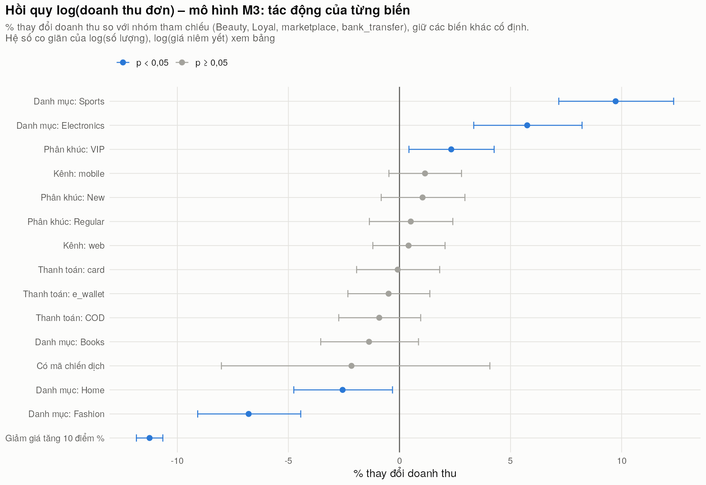
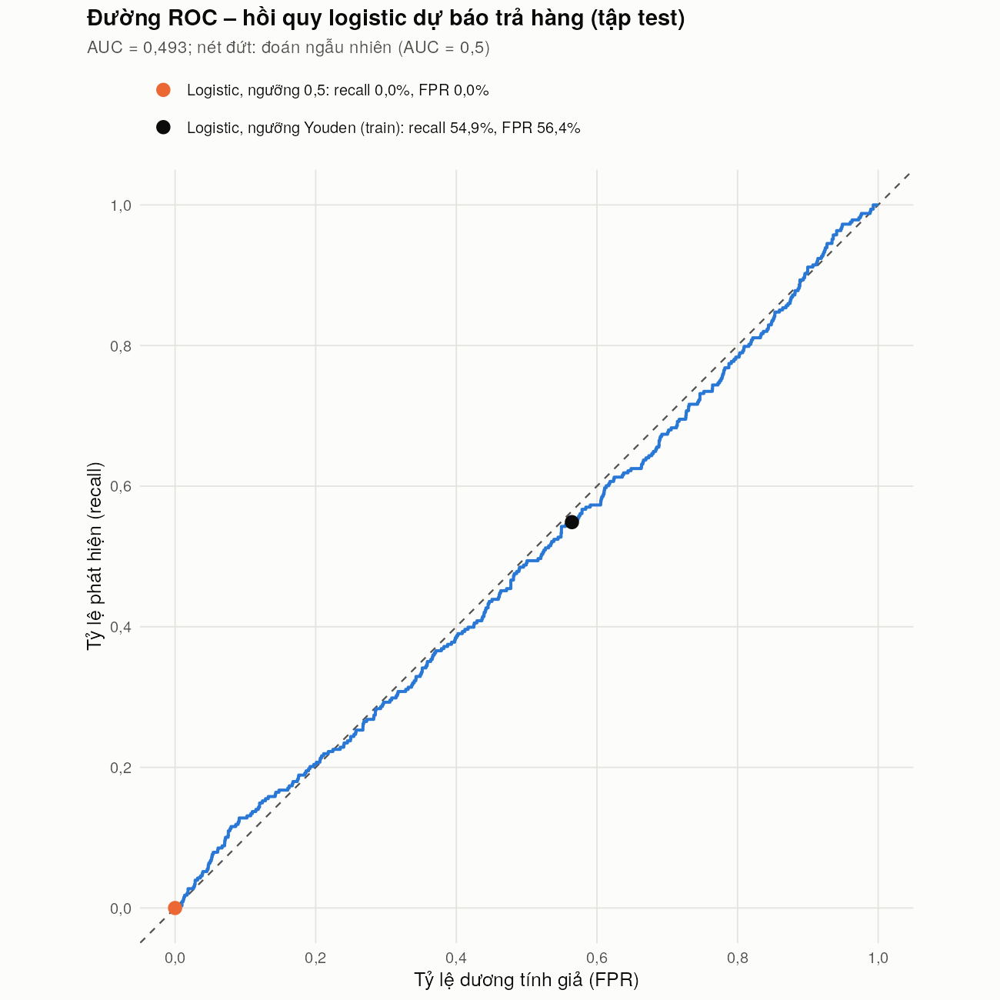

## 4.2. Kết quả phân tích

Các chỉ số và mô hình dưới đây gắn với ba mục tiêu **doanh thu, hoàn trả, giao hàng**; số liệu lấy từ `src/cau06_spark/output/` và `src/cau09_r/output/`.

### 4.2.1. KPI tổng quan theo ba mục tiêu

KPI mốc đã nêu ở mục 1.3.5 và trên dashboard [Hình:c08-dashboard]. Ngưỡng "giao trễ" là > 5 ngày (P90), ứng với 1.010 đơn.

*[Bảng:c09-ma-tran-tra]. Tỷ lệ trả hàng (%) theo danh mục × phân khúc khách hàng (SQL JOIN + GROUP BY, xoay bằng `pivot_wider`)*

| Danh mục | Loyal | New | Regular | VIP |
|---|---:|---:|---:|---:|
| Beauty | 9,31 | 6,57 | 7,09 | 7,45 |
| Books | 6,99 | 7,71 | 7,98 | 7,69 |
| Electronics | 6,56 | 6,87 | 8,85 | 7,84 |
| Fashion | 9,47 | 9,11 | 6,30 | 9,26 |
| Home | 6,38 | 8,13 | 7,19 | 8,25 |
| Sports | 6,79 | 9,38 | 7,41 | 7,84 |

**Nhận xét [Bảng:c09-ma-tran-tra]:** Bảng là kết quả JOIN `fact_main` – `item_master` – `entity_master`, GROUP BY danh mục và phân khúc (412–772 đơn mỗi ô), được ghi lại vào CSDL. Fashion có 3/4 phân khúc trả trên 9%, nhưng các ô dao động 6,30–9,47% không theo quy luật rõ, phần lớn là ngẫu nhiên (mục 4.2.3).

### 4.2.2. Sản phẩm tăng trưởng nhanh và khách hàng có nguy cơ rời bỏ (Câu 6)

Định nghĩa chỉ số ở mục 3.4.3; cửa sổ **R** = 05–07/2026 (92 ngày), **P** = 02–04/2026 (89 ngày).

*[Bảng:c06-tang-truong-danh-muc]. Tăng trưởng doanh thu 3 tháng cuối (R) so với 3 tháng trước (P) theo danh mục (`growth_by_category.csv`, `growth_summary.csv`)*

| Danh mục | Sản phẩm | Tăng nhanh | Tăng doanh thu (%) |
|---|---:|---:|---:|
| Fashion | 53 | 14 | +27,57 |
| Beauty | 61 | 11 | +18,46 |
| Books | 83 | 12 | +14,61 |
| Electronics | 70 | 7 | +2,27 |
| Sports | 62 | 9 | −2,87 |
| Home | 71 | 11 | −4,21 |
| **Toàn sàn** | **400** | **64** | **+8,02** |

**Nhận xét [Bảng:c06-tang-truong-danh-muc]:**
- Toàn sàn tăng 8,02% (khoảng 4,5% nếu tính theo ngày); 19 tháng không có xu hướng dài hạn (mục 4.3), nên đây là biến động ngắn hạn.
- 64 sản phẩm "tăng trưởng nhanh" (doanh thu và số lượng cùng tăng ≥ 50%) tạo 25,8% doanh thu R, nhưng **tín hiệu rất yếu**: mỗi sản phẩm chỉ khoảng 6 đơn mỗi cửa sổ; chỉ 6 sản phẩm tăng và 4 giảm có ý nghĩa (|z| ≥ 1,96), ít hơn mức khoảng 10 mỗi phía do ngẫu nhiên. Chỉ **P0317** vừa tăng nhanh vừa có ý nghĩa (z = 2,00; xem `fast_growing_products.csv`), nên danh sách chỉ là **cảnh báo sớm**.

**Khách hàng có nguy cơ rời bỏ** (chi tiết theo phân khúc: [Bảng:c06-roi-bo-phan-khuc], Phụ lục B). 147 khách (12,25%) ở mức **HIGH** (không mua hơn 90 ngày, số đơn 6 tháng cuối giảm) và 222 khách MEDIUM tạo danh sách 369 khách cần giữ chân; VIP có tỷ lệ HIGH (13,71%) không thấp hơn New (13,53%). Tuy vậy, ngẫu nhiên đã cho khoảng 211 khách không mua trong 90 ngày cuối (thực tế 188), nên HIGH chỉ có nghĩa "lâu chưa quay lại". Khách HIGH mua ít hơn nhóm LOW nhưng không trả nhiều hơn hay giao chậm hơn, nên cần nhắc mua lại (mục 4.5.4).

**Đối chiếu luồng sự kiện.** Cả 5.000 sự kiện JSON khớp mã đơn; 4.793 thuộc đơn sạch, 207 (4,1%) thuộc đơn bị loại (`reconcile_events.csv`). Cộng nhầm sự kiện vào doanh thu sẽ làm doanh thu cao hơn 33,2%, nên pipeline chỉ dùng sự kiện để đặt cờ `seen_in_stream` (kiến trúc Lambda, mục 1.3.7).

### 4.2.3. Các yếu tố liên quan đến hoàn trả và thời gian giao

Kiểm định χ² (tỷ lệ trả, 9 yếu tố) và ANOVA (thời gian giao, 3 yếu tố) đầy đủ ở [Bảng:c09-kiem-dinh] (Phụ lục B). Kết quả chính:

- **Không yếu tố nào liên hệ có ý nghĩa thống kê với tỷ lệ trả** ở mức 5%; gần nhất là kênh bán (marketplace 7,10%, web 8,12%; p = 0,128), còn danh mục cho p = 0,839, ô danh mục × tỉnh cho p = 0,529. Giao trễ không làm tăng trả hàng (giao > 5 ngày trả 7,82%, giao 0–2 ngày trả 7,80%), giảm giá cũng vậy (p = 0,967).
- Thời gian giao gần như bằng nhau giữa các tỉnh (p = 0,611); giữa các danh mục có khác biệt ý nghĩa (p = 0,024) nhưng chỉ 0,14 ngày. Dữ liệu giả lập gần đồng đều, nên các chênh lệch trên dashboard (mục 4.3) cần đọc cùng các kiểm định này.

### 4.2.4. Hồi quy doanh thu đơn hàng

**Thiết kế.** Vì `net_revenue = quantity × unit_price × (1 − discount_rate) + shipping_fee` đúng với mọi đơn, hồi quy theo đủ các thành phần (M0) cho R² ≈ 1 mà không thêm hiểu biết. Vì vậy M1–M3 dự báo `log(net_revenue)` **không dùng `unit_price`, `shipping_fee`**, M4 ở mức khách; chia train/test 70/30 (`set.seed(2026)`).

*[Bảng:c09-hoi-quy-so-sanh]. So sánh các mô hình hồi quy doanh thu (`hoi_quy_so_sanh.csv`)*

| Mô hình | Biến giải thích | R² train | R² test | RMSE test (log) |
|---|---|---:|---:|---:|
| M0 | các thành phần công thức | 0,9999 | 0,9999 | 0,0089 |
| M1 | danh mục, phân khúc, kênh, thanh toán, chiến dịch, giảm giá | 0,0289 | 0,0158 | 0,8026 |
| M2 | M1 + `log(quantity)` | 0,5804 | 0,5922 | 0,5166 |
| **M3** | M2 + `log(list_price)` | **0,8228** | **0,8325** | **0,3311** |
| M4 (mức khách) | 6 thuộc tính khách (phân khúc, tuổi, giới tính…) | 0,0121 (adj 0,0021) | – | – |

**Nhận xét [Bảng:c09-hoi-quy-so-sanh]:** Yếu tố kinh doanh (M1) giải thích chưa tới 3% biến thiên doanh thu đơn; **quy mô giỏ hàng** (M2) và **mức giá sản phẩm** (M3) mới là phần chính; R² test không thấp hơn R² train nên không quá khớp. Thuộc tính khách (M4) gần như không giải thích được mức chi tiêu.

{width=70%}

*[Hình:c09-hoi-quy-he-so]. Tác động của từng biến trong M3 lên doanh thu đơn (% thay đổi, khoảng tin cậy 95%)*

**Nhận xét [Hình:c09-hoi-quy-he-so]** (bảng hệ số: [Bảng:c09-hoi-quy-he-so], Phụ lục B):
- Hệ số chính của M3 (p < 0,001): `log(quantity)` 0,992, `log(list_price)` 0,427; giảm giá tăng 10 điểm % làm doanh thu đơn giảm 11,25%; cùng giá và số lượng, Sports cao hơn Beauty 9,73%, Fashion thấp hơn 6,79%. Kênh bán, thanh toán, chiến dịch không có ý nghĩa (p > 0,16).
- `log(quantity)` chiếm 55,2% tổng bình phương, `log(list_price)` 24,2%, giảm giá 2,5%: đòn bẩy doanh thu là **số lượng mỗi đơn** và **sản phẩm giá cao** (mục 4.5.4). Phần dư có đuôi dày hơn chuẩn ([Hình:c09-hoi-quy-phan-du], Phụ lục B), nên dự báo từng đơn nhỏ chỉ gần đúng.

### 4.2.5. Phân loại khả năng trả hàng

**Thiết kế.** Hồi quy logistic (`glm`, họ binomial) [TL:islr] dự báo `returned_flag` từ 13 biến (Phụ lục B), đánh giá trên 4.288 đơn test (328 đơn trả, 7,65%) và so với **baseline** luôn đoán "không trả"; ngưỡng Youden chọn trên tập train.

*[Bảng:c09-phan-loai]. Kết quả phân loại trên tập test (`phan_loai_chi_so.csv`, 4.288 đơn)*

| Cách dự báo | Ngưỡng | TP | FP | Accuracy | Precision | Recall | AUC |
|---|---:|---:|---:|---:|---:|---:|---:|
| Baseline: luôn đoán không trả | – | 0 | 0 | 92,35% | – | 0% | 0,500 |
| Logistic | 0,5 | 0 | 0 | 92,35% | – | 0% | 0,493 |
| Logistic | 0,0758 (Youden) | 180 | 2.235 | 44,43% | 7,45% | 54,88% | 0,493 |

{width=55%}

*[Hình:c09-roc]. Đường ROC của mô hình logistic trên tập test*

**Nhận xét [Bảng:c09-phan-loai] và [Hình:c09-roc]:**
- **Accuracy dễ gây hiểu lầm khi lớp mất cân bằng:** xác suất dự báo cao nhất chỉ 0,1246, nên ở ngưỡng 0,5 mô hình đoán "không trả" cho mọi đơn, accuracy đúng bằng baseline. Ở ngưỡng Youden, precision 7,45% chỉ ngang tỷ lệ trả nền.
- **AUC test 0,493** (train 0,548), ROC bám đường chéo; kiểm định tỷ số hợp lý so với mô hình rỗng cho p = 0,797, McFadden R² = 0,0034.
- **Kết luận:** với các trường hiện có, không dự báo được đơn nào sẽ bị trả; cân bằng lớp chỉ dịch ngưỡng, không tăng AUC khi tín hiệu gần bằng 0 [TL:islr]. Cần thu thêm dữ liệu như lý do trả (mục 4.5.4).
