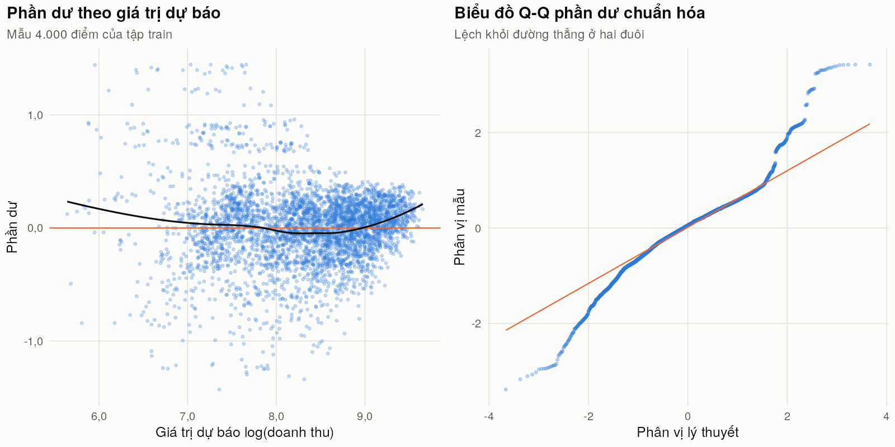

## 4.2. Kết quả phân tích

Mục này trình bày các chỉ số và mô hình gắn với ba mục tiêu **doanh thu, hoàn trả, giao hàng**, tính trên 14.408 đơn sạch. Số liệu mô hình lấy từ `src/cau09_r/output/` (lệnh `bash src/cau09_r/chay.sh`).

### 4.2.1. KPI tổng quan theo ba mục tiêu

Các KPI mốc đã nêu ở mục 1.3.5 và trên dashboard [Hình:c08-dashboard]; `test.sh` của Câu 8 tính lại độc lập và khớp. Ngưỡng "giao trễ" là > 5 ngày (P90), ứng với 1.010 đơn.

*[Bảng:c09-ma-tran-tra]. Tỷ lệ trả hàng (%) theo danh mục × phân khúc khách hàng (SQL JOIN + GROUP BY, xoay bằng `pivot_wider`)*

| Danh mục | Loyal | New | Regular | VIP |
|---|---:|---:|---:|---:|
| Beauty | 9,31 | 6,57 | 7,09 | 7,45 |
| Books | 6,99 | 7,71 | 7,98 | 7,69 |
| Electronics | 6,56 | 6,87 | 8,85 | 7,84 |
| Fashion | 9,47 | 9,11 | 6,30 | 9,26 |
| Home | 6,38 | 8,13 | 7,19 | 8,25 |
| Sports | 6,79 | 9,38 | 7,41 | 7,84 |

**Nhận xét [Bảng:c09-ma-tran-tra]:**
- Bảng là kết quả truy vấn JOIN `fact_main` – `item_master` – `entity_master`, GROUP BY danh mục và phân khúc (412–772 đơn mỗi ô), ghi vào bảng `kq_ma_tran_ty_le_tra` của CSDL.
- Fashion có 3/4 phân khúc trả trên 9%, nhưng các ô dao động 6,30–9,47% không theo quy luật rõ; theo [Bảng:c09-kiem-dinh], phần lớn chênh lệch là ngẫu nhiên.

### 4.2.2. Sản phẩm tăng trưởng nhanh và khách hàng có nguy cơ rời bỏ (Câu 6)

Số liệu lấy từ `src/cau06_spark/output/`, định nghĩa chỉ số ở mục 3.4.3. Cửa sổ so sánh: **R** = 05–07/2026 (92 ngày), **P** = 02–04/2026 (89 ngày).

**a) Sản phẩm tăng trưởng nhanh**

*[Bảng:c06-tang-truong-danh-muc]. Doanh thu 3 tháng cuối (R) so với 3 tháng trước (P) theo danh mục (`growth_by_category.csv`, `growth_summary.csv`)*

| Danh mục | Sản phẩm | Tăng nhanh | Doanh thu P | Doanh thu R | Tăng (%) |
|---|---:|---:|---:|---:|---:|
| Fashion | 53 | 14 | 1.446.314,97 | 1.845.055,94 | +27,57 |
| Beauty | 61 | 11 | 1.605.487,84 | 1.901.915,97 | +18,46 |
| Books | 83 | 12 | 2.345.141,27 | 2.687.824,14 | +14,61 |
| Electronics | 70 | 7 | 2.168.640,33 | 2.217.841,09 | +2,27 |
| Sports | 62 | 9 | 1.925.758,83 | 1.870.583,08 | −2,87 |
| Home | 71 | 11 | 2.209.685,05 | 2.116.594,22 | −4,21 |
| **Toàn sàn** | **400** | **64** | **11.701.028,29** | **12.639.814,44** | **+8,02** |

**Nhận xét [Bảng:c06-tang-truong-danh-muc]:**
- Doanh thu toàn sàn tăng 8,02% (khoảng 4,5% nếu tính theo ngày); Fashion, Beauty, Books tăng mạnh nhất, Home và Sports giảm nhẹ. Dữ liệu 19 tháng không có xu hướng dài hạn rõ (mục 4.3), nên đây là biến động ngắn hạn. 61/400 sản phẩm có dưới 3 đơn ở một cửa sổ bị loại khỏi xếp hạng để tránh mức tăng ảo.

*[Bảng:c06-top-tang-truong]. 5 sản phẩm tăng trưởng nhanh nhất (`fast_growing_products.csv`)*

| Sản phẩm | Danh mục | Đơn P → R | Doanh thu R | Tăng doanh thu (%) | z (số đơn) |
|---|---|---:|---:|---:|---:|
| P0317 | Books | 4 → 12 | 30.925,25 | +352,42 | **2,00** |
| P0347 | Books | 4 → 10 | 68.915,66 | +327,76 | 1,60 |
| P0177 | Home | 3 → 7 | 45.654,10 | +315,25 | 1,26 |
| P0089 | Home | 3 → 9 | 68.721,08 | +298,77 | 1,73 |
| P0275 | Electronics | 4 → 7 | 76.308,34 | +298,41 | 0,90 |

**Nhận xét [Bảng:c06-top-tang-truong]:**
- 64 sản phẩm đạt tiêu chí "tăng trưởng nhanh" (doanh thu và số lượng cùng tăng ≥ 50%, xu hướng 19 tháng đi lên), tạo 3.263.506,44 doanh thu trong R (25,8% toàn sàn).
- **Tín hiệu thống kê rất yếu:** mỗi sản phẩm chỉ khoảng 6 đơn mỗi cửa sổ; chỉ 6 sản phẩm tăng và 4 sản phẩm giảm có ý nghĩa (|z| ≥ 1,96), ít hơn mức khoảng 10 mỗi phía do ngẫu nhiên. Chỉ **P0317** vừa tăng nhanh vừa có ý nghĩa (z = 2,00). Danh sách vì vậy chỉ là **cảnh báo sớm** để theo dõi thêm 1–2 tháng.

**b) Khách hàng có nguy cơ rời bỏ**

*[Bảng:c06-roi-bo-phan-khuc]. Mức nguy cơ rời bỏ theo phân khúc khách hàng (`churn_summary.csv`)*

| Phân khúc | Khách | HIGH | MEDIUM | LOW | HIGH (%) | Recency TB (ngày) |
|---|---:|---:|---:|---:|---:|---:|
| Loyal | 296 | 28 | 51 | 217 | 9,46 | 44,66 |
| New | 303 | 41 | 48 | 214 | 13,53 | 51,10 |
| Regular | 302 | 37 | 61 | 204 | 12,25 | 50,00 |
| VIP | 299 | 41 | 62 | 196 | 13,71 | 49,35 |
| **Tất cả** | **1.200** | **147** | **222** | **831** | **12,25** | **48,80** |

**Nhận xét [Bảng:c06-roi-bo-phan-khuc]:**
- 147 khách (12,25%) ở mức **HIGH** (không mua hơn 90 ngày, số đơn 6 tháng cuối giảm) và 222 khách MEDIUM tạo danh sách 369 khách (`churn_risk_customers.csv`) cho chiến dịch giữ chân. VIP có tỷ lệ HIGH không thấp hơn New (13,71% so với 13,53%).
- **Đường cơ sở:** nếu không ai rời bỏ, ngẫu nhiên đã cho khoảng 211 khách không mua trong 90 ngày cuối, thực tế là 188; nhãn HIGH chỉ nên hiểu là "lâu chưa quay lại".
- Khách HIGH mua ít đơn hơn nhóm LOW (9,82 so với 12,31 đơn/khách) nhưng **không** bị trả nhiều hơn (7,48% so với 7,86%) hay giao chậm hơn (3,05 so với 3,03 ngày) (`churn_by_risk.csv`), nên giữ chân cần tập trung vào nhắc mua lại (mục 4.5.4).

**c) Đối chiếu luồng sự kiện với dữ liệu lô**

*[Bảng:c06-doi-chieu-luong]. Đối chiếu 5.000 sự kiện JSON với đơn hàng (`reconcile_events.csv`)*

| Chỉ số | Giá trị |
|---|---:|
| Sự kiện / khớp được mã đơn | 5.000 / 5.000 |
| Lệch thời điểm, nguồn, danh mục, phân khúc, doanh thu, cờ trả | 0 / 0 / 0 / 0 / 0 / 0 |
| Sự kiện của đơn sạch (OK + MISSING) | 4.793 (4.679 OK, 114 MISSING) |
| Sự kiện của đơn bị loại | 207 (99 OUTLIER, 57 DUPLICATE, 51 LATE) |
| Doanh thu trong sự kiện (tất cả / chỉ đơn sạch) | 28.406.526,37 / 25.969.005,67 |

**Nhận xét [Bảng:c06-doi-chieu-luong]:**
- Luồng sự kiện là bản sao trung thực của 5.000 đơn đầu; cộng nhầm vào doanh thu sẽ cho 104.187.346,89 (cao hơn 33,2%), nên pipeline chỉ dùng sự kiện để đặt cờ `seen_in_stream`.
- 207 sự kiện (4,1%) thuộc đơn bị loại, nên số liệu của lớp tốc độ chỉ là tạm thời và được lớp lô hiệu chỉnh (kiến trúc Lambda, mục 1.3.7).

### 4.2.3. Các yếu tố liên quan đến hoàn trả và thời gian giao

*[Bảng:c09-kiem-dinh]. Kiểm định sự khác biệt về tỷ lệ trả (χ²) và thời gian giao (ANOVA một chiều)*

| Chỉ số | Yếu tố | Số mức | Thống kê | p-value |
|---|---|---:|---:|---:|
| Tỷ lệ trả | Kênh bán | 3 | χ² = 4,110 | 0,1281 |
| Tỷ lệ trả | Có/không đánh giá | 2 | χ² = 0,951 | 0,3294 |
| Tỷ lệ trả | Ô danh mục × tỉnh | 108 | χ² = 105,269 | 0,5292 |
| Tỷ lệ trả | Thanh toán | 4 | χ² = 2,102 | 0,5516 |
| Tỷ lệ trả | Tỉnh giao hàng | 18 | χ² = 15,589 | 0,5532 |
| Tỷ lệ trả | Phân khúc | 4 | χ² = 1,196 | 0,7540 |
| Tỷ lệ trả | Danh mục | 6 | χ² = 2,071 | 0,8392 |
| Tỷ lệ trả | Thời gian giao (0–2 / 3–5 / > 5 ngày) | 3 | χ² = 0,089 | 0,9567 |
| Tỷ lệ trả | Mức giảm giá | 6 | χ² = 0,942 | 0,9671 |
| Ngày giao | Tỉnh giao hàng | 18 | F = 0,869 | 0,6114 |
| Ngày giao | Danh mục | 6 | F = 2,597 | 0,0236 |
| Ngày giao | Kênh bán | 3 | F = 2,776 | 0,0623 |

**Nhận xét [Bảng:c09-kiem-dinh]:**
- **Không yếu tố nào liên hệ có ý nghĩa thống kê với tỷ lệ trả** ở mức 5%; gần nhất là kênh bán (marketplace 7,10%, web 8,12%; p = 0,128). Giao trễ không làm tăng trả hàng (giao > 5 ngày trả 7,82%, giao 0–2 ngày trả 7,80%), giảm giá cũng vậy (p = 0,967).
- Thời gian giao gần như bằng nhau giữa các tỉnh (p = 0,611); giữa các danh mục có khác biệt ý nghĩa (p = 0,024) nhưng chỉ 0,14 ngày. Đây là dấu hiệu của dữ liệu giả lập gần đồng đều, nên các chênh lệch trên dashboard (mục 4.3) cần đọc cùng bảng này.

### 4.2.4. Hồi quy doanh thu đơn hàng

**Thiết kế.** Vì `net_revenue = quantity × unit_price × (1 − discount_rate) + shipping_fee` đúng với mọi đơn, hồi quy theo đủ các thành phần này (M0) cho R² ≈ 1 mà không thêm hiểu biết. Nhóm dùng `log(net_revenue)` và các mô hình lồng nhau **không dùng `unit_price`, `shipping_fee`** (M1–M3), cộng mô hình mức khách M4; chia train/test 70/30 với `set.seed(2026)`.

*[Bảng:c09-hoi-quy-so-sanh]. So sánh các mô hình hồi quy doanh thu (`hoi_quy_so_sanh.csv`)*

| Mô hình | Biến giải thích | n train | R² train | R² test | RMSE test (log) |
|---|---|---:|---:|---:|---:|
| M0 | `log(quantity)`, `log(unit_price)`, `log(1 − discount_rate)`, `shipping_fee` | 10.120 | 0,9999 | 0,9999 | 0,0089 |
| M1 | danh mục, phân khúc, kênh, thanh toán, có chiến dịch, giảm giá | 10.120 | 0,0289 | 0,0158 | 0,8026 |
| M2 | M1 + `log(quantity)` | 10.120 | 0,5804 | 0,5922 | 0,5166 |
| **M3** | M2 + `log(list_price)` | 10.120 | **0,8228** | **0,8325** | **0,3311** |
| M4 (mức khách) | phân khúc, nhóm tuổi, giới tính, điểm thân thiết, kênh ưa thích, thâm niên | 1.200 | 0,0121 (adj 0,0021) | – | – |

**Nhận xét [Bảng:c09-hoi-quy-so-sanh]:**
- Yếu tố kinh doanh (M1) giải thích chưa tới 3% biến thiên doanh thu đơn; **quy mô giỏ hàng** (M2, R² test 0,592) và **mức giá sản phẩm** (M3, R² test 0,833) mới là phần chính. R² test không thấp hơn R² train, tức mô hình không quá khớp.
- M4 gần như không giải thích được doanh thu theo khách (adj R² 0,0021): phân khúc, tuổi, giới tính hay điểm thân thiết không cho biết khách nào chi nhiều hơn.

*[Hình:c09-hoi-quy-he-so]. Tác động của từng biến trong M3 lên doanh thu đơn (% thay đổi, khoảng tin cậy 95%)*

**Nhận xét [Hình:c09-hoi-quy-he-so]** (bảng hệ số đầy đủ: [Bảng:c09-hoi-quy-he-so], Phụ lục B):
- Hệ số chính của M3 (p < 0,001): `log(quantity)` 0,992, `log(list_price)` 0,427; giảm giá tăng 10 điểm % làm doanh thu đơn giảm 11,25%; cùng giá và số lượng, Sports cao hơn Beauty 9,73%, Fashion thấp hơn 6,79%. Kênh bán, thanh toán, chiến dịch không có ý nghĩa (p > 0,16).
- `log(quantity)` chiếm 55,2% tổng bình phương, `log(list_price)` 24,2%, giảm giá 2,5% (`hoi_quy_anova.csv`): đòn bẩy doanh thu là **số lượng mỗi đơn** và **cơ cấu sản phẩm giá cao** (khuyến nghị ở mục 4.5.4).

*[Hình:c09-hoi-quy-phan-du]. Kiểm tra phần dư của M3: phần dư theo giá trị dự báo và biểu đồ Q-Q*

**Nhận xét [Hình:c09-hoi-quy-phan-du]:**
- Phần dư gần đối xứng nhưng đuôi dày hơn chuẩn (Q-Q cong ở hai đuôi); đường loess cong lên ở vùng dự báo thấp vì phí vận chuyển (0–50) là khoản cộng thêm cố định. Hệ số vẫn đáng tin để so sánh tác động, còn dự báo cho từng đơn nhỏ chỉ gần đúng (chi tiết ở Phụ lục B, mã nguồn E).

### 4.2.5. Phân loại khả năng trả hàng

**Thiết kế.** Hồi quy logistic (`glm`, họ binomial) [TL:islr] dự báo `returned_flag` từ 13 biến (danh sách ở Phụ lục B, mã nguồn E), huấn luyện trên 10.120 đơn, đánh giá trên 4.288 đơn test (328 đơn trả, 7,65%). Mô hình được so với **baseline đa số** (luôn đoán "không trả") ở ngưỡng 0,5 và ngưỡng Youden chọn trên tập **train**; AUC tính theo công thức hạng Mann–Whitney.

*[Bảng:c09-phan-loai]. Kết quả phân loại trên tập test (`phan_loai_chi_so.csv`, 4.288 đơn)*

| Cách dự báo | Ngưỡng | TP | FP | TN | FN | Accuracy | Precision | Recall | F1 | AUC |
|---|---:|---:|---:|---:|---:|---:|---:|---:|---:|---:|
| Baseline: luôn đoán không trả | – | 0 | 0 | 3.960 | 328 | 92,35% | – | 0% | 0 | 0,500 |
| Logistic | 0,5 | 0 | 0 | 3.960 | 328 | 92,35% | – | 0% | 0 | 0,493 |
| Logistic | 0,0758 (Youden) | 180 | 2.235 | 1.725 | 148 | 44,43% | 7,45% | 54,88% | 0,131 | 0,493 |

*[Hình:c09-roc]. Đường ROC của mô hình logistic trên tập test*

**Nhận xét [Bảng:c09-phan-loai] và [Hình:c09-roc]:**
- **Accuracy dễ gây hiểu lầm khi lớp mất cân bằng:** xác suất dự báo cao nhất chỉ 0,1246, nên ở ngưỡng 0,5 mô hình đoán "không trả" cho mọi đơn; accuracy 92,35% đúng bằng baseline, recall bằng 0. Ở ngưỡng 0,0758, precision 7,45% ngang tỷ lệ trả nền, tức không chọn lọc hơn ngẫu nhiên.
- **AUC test 0,493** (train 0,548), ROC bám sát đường chéo; kiểm định tỷ số hợp lý so với mô hình rỗng cho p = 0,797, McFadden R² = 0,0034.
- **Kết luận:** với các trường hiện có, không dự báo được đơn nào sẽ bị trả; cân bằng lớp chỉ dịch ngưỡng, không tăng AUC khi tín hiệu gần bằng 0 [TL:islr]. Cần thu thêm dữ liệu như lý do trả (mục 4.5.4). Dự báo từng đơn test được ghi vào bảng `kq_phan_loai_du_doan`.
