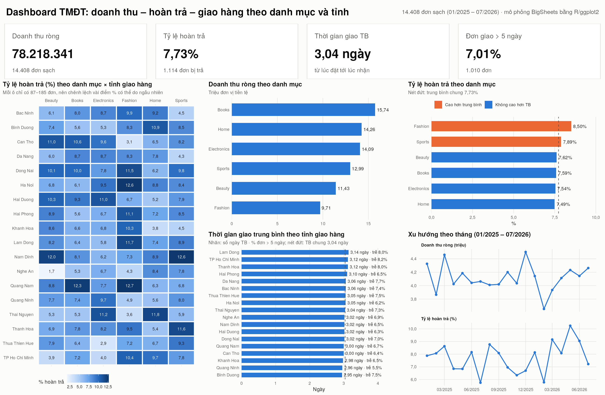
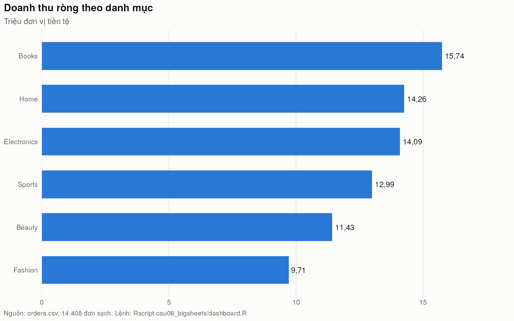
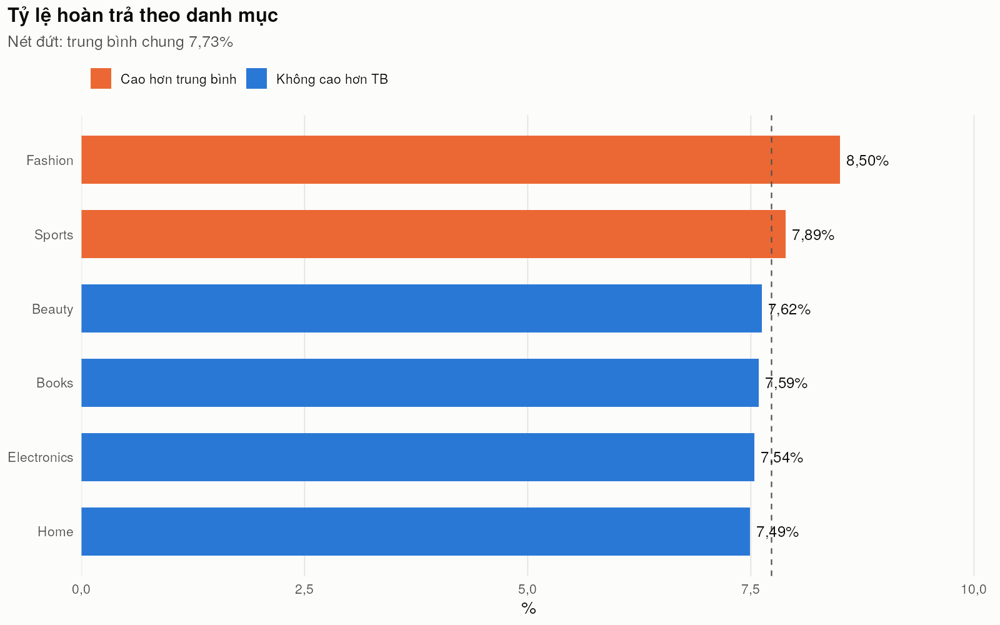
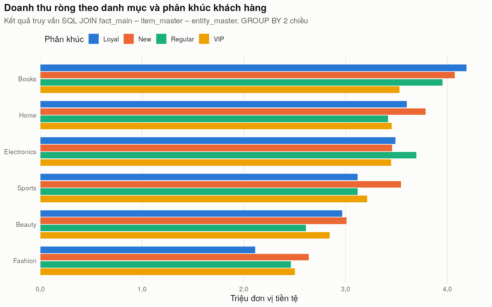
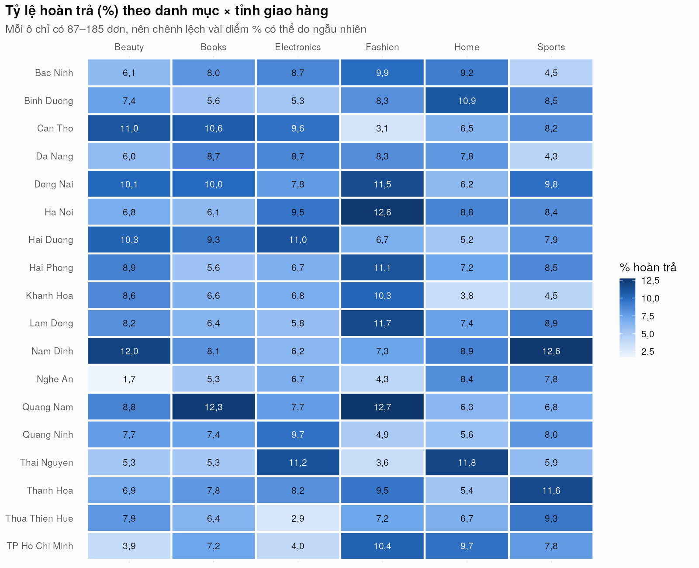
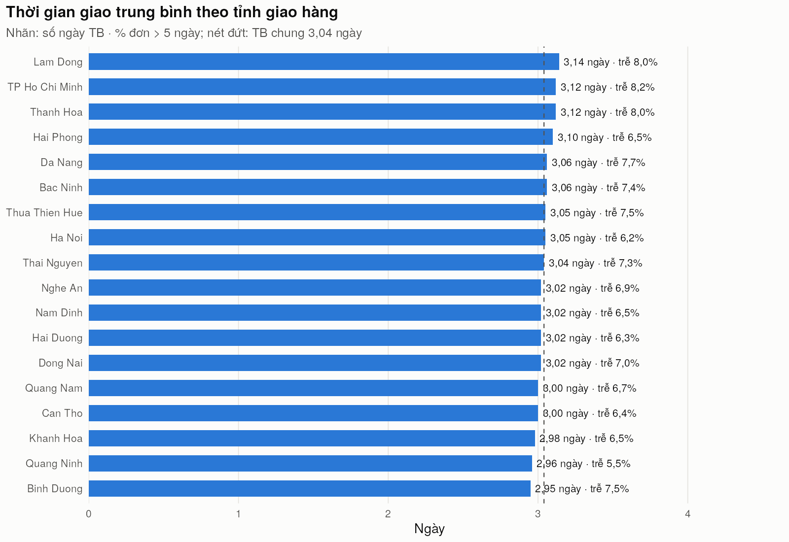
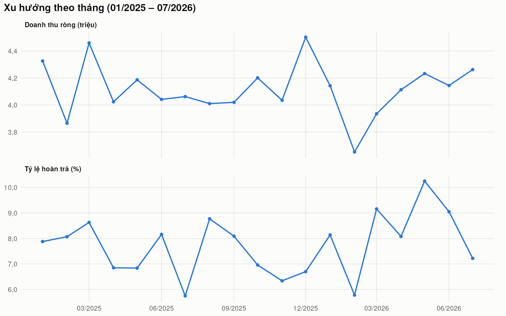
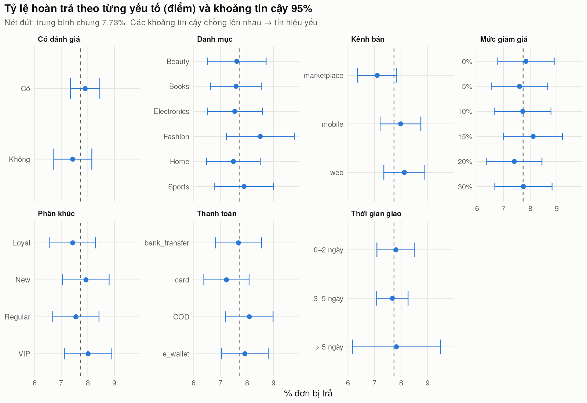

## 4.3. Trực quan hóa

Các hình được vẽ bằng ggplot2 [TL:wickham-ggplot2] với giao diện chung: màu cam đánh dấu nhóm cao hơn trung bình, nét đứt là trung bình chung. Dashboard của Câu 8 mô phỏng các bước BigSheets B1–B8 (`src/cau08_bigsheets/huong-dan-bigsheets.md`); số liệu nằm trong `src/cau08_bigsheets/output/` và `src/cau09_r/output/`.

### 4.3.1. Dashboard doanh thu – hoàn trả – giao hàng

*[Hình:c08-dashboard]. Dashboard tổng hợp theo danh mục và tỉnh giao hàng (mô phỏng BigSheets bằng R/ggplot2)*

**Nhận xét [Hình:c08-dashboard]:**
- Hàng KPI trả lời ngay ba mục tiêu (số liệu như mục 1.3.5). Các biểu đồ bên dưới đi sâu theo hai chiều mà đề yêu cầu, **danh mục** (doanh thu, tỷ lệ trả) và **tỉnh giao hàng** (thời gian giao, ma trận hoàn trả), kèm xu hướng theo tháng.
- 5 biểu đồ được ghép bằng gói `grid`, tương ứng bước B8 của BigSheets.

### 4.3.2. Doanh thu và hoàn trả theo danh mục

*[Hình:c08-doanh-thu-danh-muc]. Doanh thu ròng theo danh mục (triệu)*

**Nhận xét [Hình:c08-doanh-thu-danh-muc]:** Books dẫn đầu với 15,74 triệu (20,1% doanh thu), Fashion thấp nhất với 9,71 triệu. Chênh lệch chủ yếu do **số đơn** (Books 2.953 đơn, Fashion 1.835 đơn), không do giá trị mỗi đơn: danh mục chỉ giải thích rất ít biến thiên doanh thu đơn ([Bảng:c09-hoi-quy-so-sanh]).

*[Hình:c08-hoan-tra-danh-muc]. Tỷ lệ hoàn trả theo danh mục, nét đứt là trung bình chung 7,73%*

**Nhận xét [Hình:c08-hoan-tra-danh-muc]:** Fashion (8,50%) và Sports (7,89%) cao hơn trung bình, bốn danh mục còn lại ở mức 7,49–7,62%. Fashion vừa ít doanh thu nhất vừa trả nhiều nhất nên là ứng viên đầu tiên cho biện pháp giảm hoàn trả, nhưng χ² theo danh mục cho p = 0,839 ([Bảng:c09-kiem-dinh]), nên cần thí điểm rồi đo lại.

*[Hình:c09-doanh-thu-phan-khuc]. Doanh thu ròng theo danh mục và phân khúc khách hàng (kết quả truy vấn SQL JOIN + GROUP BY trong R)*

**Nhận xét [Hình:c09-doanh-thu-phan-khuc]:** Hình vẽ trực tiếp kết quả truy vấn JOIN 3 bảng, GROUP BY danh mục × phân khúc của Câu 9 (số liệu từng ô trùng với kết quả Pig ở mục 4.1). Bốn phân khúc đóng góp gần bằng nhau trong mỗi danh mục. Riêng Fashion – Loyal vừa có doanh thu thấp nhất vừa trả nhiều nhất (9,47%, [Bảng:c09-ma-tran-tra]), là nhóm nên khảo sát lý do trả hàng.

### 4.3.3. Theo tỉnh giao hàng

*[Hình:c08-heatmap-hoan-tra]. Ma trận tỷ lệ hoàn trả (%) theo danh mục × tỉnh giao hàng*

**Nhận xét [Hình:c08-heatmap-hoan-tra]:**
- Ma trận trông có "điểm nóng" (Fashion – Quang Nam 12,7%) và ô rất thấp (Beauty – Nghe An 1,7%). Tuy vậy, mỗi ô chỉ có 87–185 đơn và χ² trên 108 ô cho p = 0,529 ([Bảng:c09-kiem-dinh]), tức mức phân tán **đúng bằng kỳ vọng nếu chỉ có ngẫu nhiên**.
- Không nên quyết định theo từng ô; với dữ liệu thật, chỉ nên cảnh báo khi một ô vượt ngưỡng nhiều kỳ liên tiếp.

*[Bảng:c08-tinh]. Tỉnh giao hàng có chỉ số giao hàng cao nhất và thấp nhất (`dashboard_province.csv`, 18 tỉnh)*

| Chỉ số | Cao nhất | Thấp nhất | Toàn bộ |
|---|---|---|---|
| Giao trung bình | Lam Dong 3,14 ngày | Binh Duong 2,95 ngày | 3,04 ngày |
| % đơn giao > 5 ngày | TP Ho Chi Minh 8,21% | Quang Ninh 5,48% | 7,01% |

**Nhận xét [Bảng:c08-tinh]:** Doanh thu và tỷ lệ trả theo tỉnh khá đều (mục 4.1). Thời gian giao trung bình chỉ chênh 0,19 ngày giữa các tỉnh (ANOVA p = 0,611), nhưng tỷ lệ đơn trễ chênh nhiều hơn, nên với mục tiêu giao hàng cần theo dõi **% đơn trễ** theo tỉnh vì số ngày trung bình che mất phần đuôi.

*[Hình:c08-giao-hang-tinh]. Thời gian giao trung bình và tỷ lệ đơn giao > 5 ngày theo tỉnh giao hàng*

**Nhận xét [Hình:c08-giao-hang-tinh]:** Các cột gần như bằng nhau quanh đường trung bình 3,04 ngày. Nhãn % trễ cạnh mỗi cột giúp nhận ra các tỉnh nhiều đơn trễ (TP Ho Chi Minh, Lam Dong, Thanh Hoa, khoảng 8%) để ưu tiên làm việc với đơn vị vận chuyển; giao trễ không làm tăng hoàn trả (mục 4.2.3).

### 4.3.4. Xu hướng theo tháng và nhóm giá trị đơn

*[Hình:c08-xu-huong-thang]. Doanh thu ròng (triệu) và tỷ lệ hoàn trả (%) theo tháng, 01/2025 – 07/2026*

**Nhận xét [Hình:c08-xu-huong-thang]:**
- Hai chỉ số được vẽ ở hai khung riêng, không dùng hai trục y. Doanh thu tháng dao động 3,65–4,50 triệu (cao nhất 12/2025, thấp nhất 02/2026 do tháng ngắn), không có xu hướng dài hạn.
- Tỷ lệ trả theo tháng dao động 5,75% (07/2025) – 10,25% (05/2026); bốn tháng 03–06/2026 đều trên 8%, cần theo dõi thêm.

*[Bảng:c08-nhom-gia-tri]. Đóng góp theo nhóm giá trị đơn (`dashboard_revenue_bucket.csv`, cột tính `revenue_bucket` ở bước B4)*

| Nhóm giá trị đơn | Số đơn | Doanh thu ròng | % trả | % đơn > 5 ngày |
|---|---:|---:|---:|---:|
| < 2.000 | 2.729 | 3.496.280,32 | 7,51 | 7,37 |
| 2.000–5.000 | 5.027 | 17.098.262,35 | 8,20 | 6,52 |
| 5.000–10.000 | 4.786 | 34.033.479,44 | 7,56 | 7,48 |
| ≥ 10.000 | 1.866 | 23.590.319,11 | 7,23 | 6,59 |

**Nhận xét [Bảng:c08-nhom-gia-tri]:** Đơn từ 10.000 trở lên chỉ chiếm 12,95% số đơn nhưng mang lại 30,16% doanh thu; hai nhóm từ 5.000 trở lên chiếm 73,67% doanh thu. Tỷ lệ trả của nhóm đơn lớn (7,23%) không cao hơn nhóm khác, nên khuyến khích tăng giá trị giỏ hàng (mục 4.2.4) không làm tăng rủi ro hoàn trả.

### 4.3.5. Tỷ lệ hoàn trả theo từng yếu tố

*[Hình:c09-tra-theo-yeu-to]. Tỷ lệ hoàn trả theo 7 yếu tố, kèm khoảng tin cậy 95% (dữ liệu dạng dài tạo bằng `pivot_longer`)*

**Nhận xét [Hình:c09-tra-theo-yeu-to]:** Ở cả 7 yếu tố, **khoảng tin cậy 95% của mọi mức đều cắt đường trung bình 7,73%** (tách xa nhất là kênh marketplace, 7,10%, khoảng 6,37–7,82%). Đây là lý do trực quan khiến mô hình phân loại ở mục 4.2.5 không học được..
