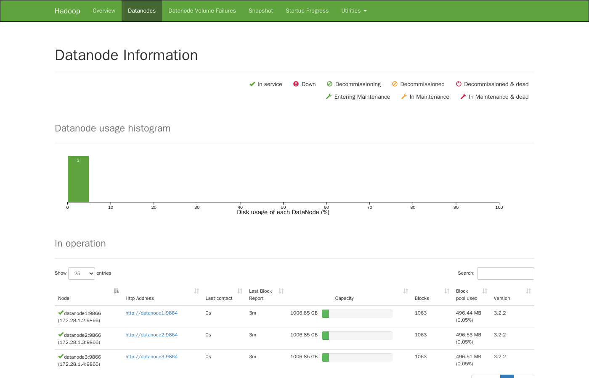
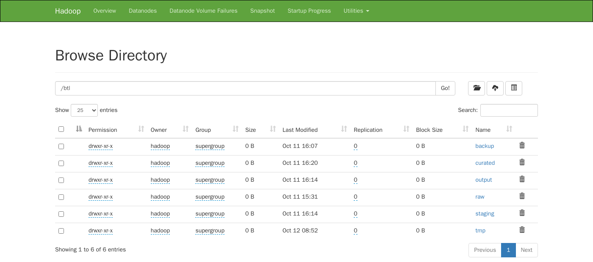
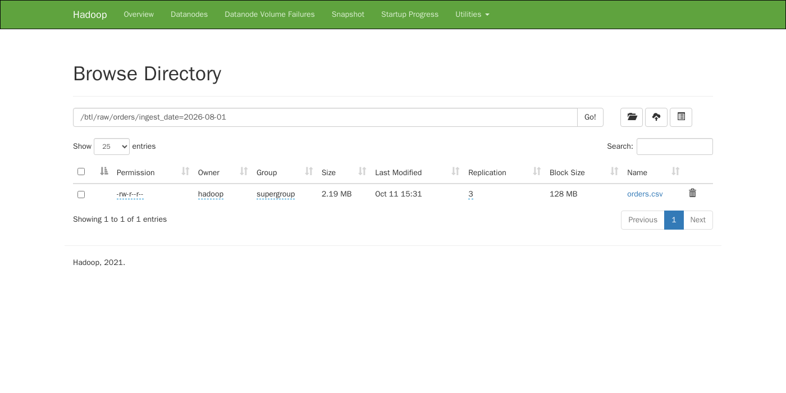
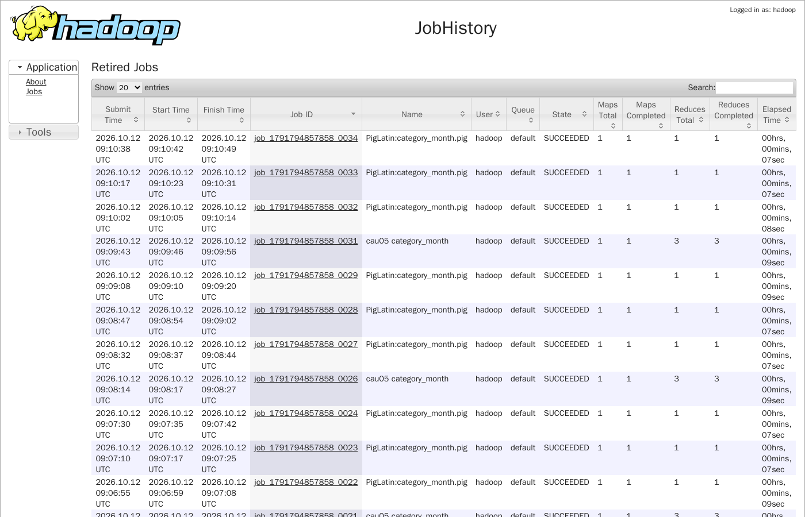
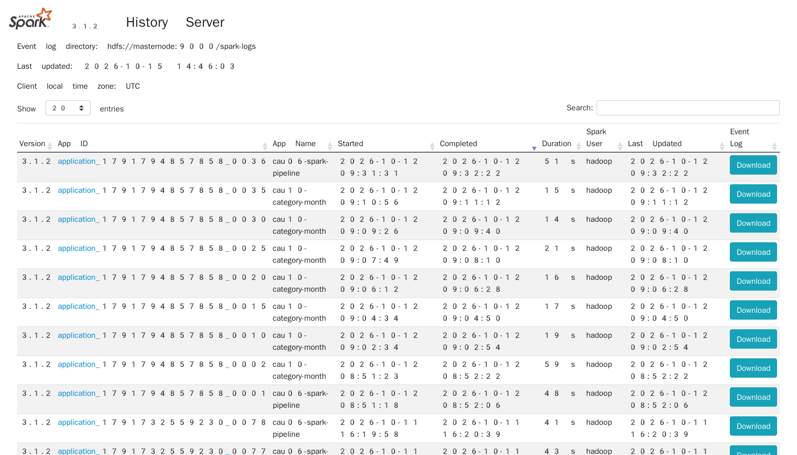
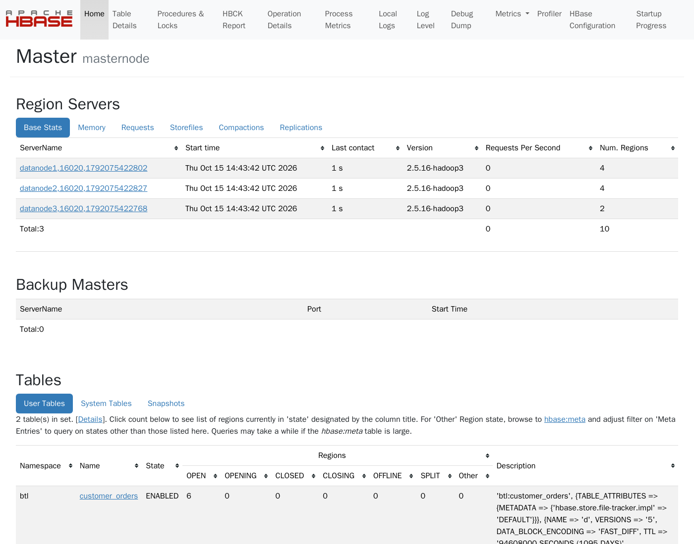

## Phụ lục C. Ảnh minh chứng kết quả

Mỗi câu có 1–3 ảnh minh chứng. Ảnh nằm trong `docs/images/` với tên `cauXX-mo-ta.png`. Ảnh đã dùng trong thân báo cáo chỉ được nhắc lại bằng nhãn, không chèn lần nữa.

### C.1. Câu 8 – Mô phỏng BigSheets và dashboard

- Dashboard tổng hợp: [Hình:c08-dashboard] (mục 4.3.1), tệp `docs/images/cau08-dashboard.png`.
- Các biểu đồ thành phần, chạy trên toàn bộ 14.408 đơn: [Hình:c08-heatmap-hoan-tra], [Hình:c08-xu-huong-thang] (mục 4.3); các tệp `cau08-doanh-thu-danh-muc.png`, `cau08-hoan-tra-danh-muc.png`, `cau08-giao-hang-tinh.png` trong `docs/images/` không chèn lại vì đã có trong dashboard.
- Số dòng sau từng bước BigSheets B1–B6 (`src/cau08_bigsheets/output/buoc_bigsheets.csv`): 15.000 → lọc còn 14.408 → join vẫn 14.408 → 108 ô danh mục × tỉnh.

### C.2. Câu 9 – R + SQLite

*[Hình:c09-minh-chung-csdl]. Các bảng `kq_*` do R ghi vào bản copy CSDL, đọc lại ở chế độ chỉ đọc; kết nối chính đã đóng (`dbIsValid = FALSE`)*

**Nhận xét [Hình:c09-minh-chung-csdl]:**
- Ảnh do chính `phan_tich.R` sinh ra sau khi chạy xong. Script mở lại tệp CSDL kết quả bằng một kết nối chỉ đọc và đếm số dòng từng bảng.
- Ảnh xác nhận hai yêu cầu cuối của Câu 9: (1) 16 bảng kết quả đã được ghi trở lại CSDL, cạnh 3 bảng gốc còn nguyên (`fact_main` 15.000 dòng); (2) kết nối đã được đóng an toàn nhờ `on.exit(dbDisconnect(con), add = TRUE)`.
- Các ảnh kết quả phân tích khác: [Hình:c09-hoi-quy-he-so], [Hình:c09-roc] (mục 4.2), [Hình:c09-hoi-quy-phan-du] (Phụ lục B), [Hình:c09-doanh-thu-phan-khuc], [Hình:c09-tra-theo-yeu-to] (mục 4.3).

### C.3. Câu 2–7 – Giao diện quản trị của cụm

Các ảnh dưới đây chụp giao diện web của cụm sau khi chạy xong các câu. Minh chứng dạng văn bản (log Flume, counter MapReduce, kết quả `hbase shell`) nằm trong thư mục `output/` của từng câu.

*[Hình:pl-hdfs-datanode]. HDFS NameNode: 3 DataNode đang hoạt động*

**Nhận xét [Hình:pl-hdfs-datanode]:** cả 3 DataNode đều *In service*, mỗi node giữ 1.063 block. Với hệ số nhân bản 3 trên 3 node, mỗi node giữ một bản sao của mọi block (mục 3.2.1).

*[Hình:pl-hdfs-vung]. Các vùng dữ liệu dưới `/btl` trên HDFS (Câu 3)*

**Nhận xét [Hình:pl-hdfs-vung]:** đủ 4 vùng `raw`, `staging`, `curated`, `output` theo thiết kế ở mục 3.2.1. Ngoài ra còn `backup` (bản xuất snapshot HBase, Câu 7) và `tmp` (dữ liệu tạm của phép đo hiệu năng, Câu 10).

*[Hình:pl-hdfs-rep3]. Bản chụp chuẩn `orders.csv` trong vùng raw, hệ số nhân bản 3*

**Nhận xét [Hình:pl-hdfs-rep3]:** tệp 2,19 MB nằm trong một block 128 MB, *Replication* = 3, đúng yêu cầu nhân bản 3 lần của Câu 3.

*[Hình:pl-jobhistory]. MapReduce JobHistory: các job Pig và MapReduce đã chạy (Câu 4, 5, 10)*

**Nhận xét [Hình:pl-jobhistory]:** mọi job đều *SUCCEEDED*. Job `cau05 category_month` có 1 map và 3 reduce, đúng với Partitioner 3 reducer ở mục 3.5. Mỗi job `PigLatin:category_month.pig` mất 7–8 s, khớp với phép đo ở mục 4.5.2.

*[Hình:pl-spark-history]. Spark History Server: các ứng dụng của Câu 6 và Câu 10*

**Nhận xét [Hình:pl-spark-history]:** các lần chạy `cau06-spark-pipeline` mất 41–51 s và `cau10-category-month` phần lớn mất 14–21 s (lần chạy thử đầu tiên 59 s, khi cụm còn bận job khác), đều chạy trên YARN, khớp với số liệu ở mục 4.4 và 4.5.

*[Hình:pl-hbase-master]. HBase Master: 3 RegionServer và bảng `btl:customer_orders` (Câu 7)*

**Nhận xét [Hình:pl-hbase-master]:** 3 RegionServer đang chạy, không có server chết. Bảng `btl:customer_orders` có 6 region đang mở, đúng với thiết kế chia trước 6 vùng ở mục 3.2.2; phần mô tả bảng cho thấy column family `d` có `VERSIONS => '5'` và TTL 1.095 ngày.
