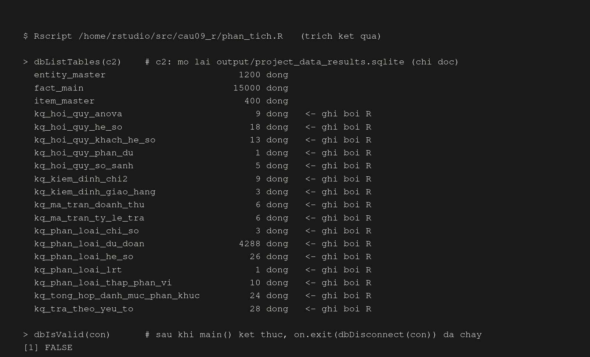

## Phụ lục C. Ảnh minh chứng kết quả

Mỗi câu có 1–3 ảnh minh chứng. Ảnh nằm trong `docs/images/` với tên `cauXX-mo-ta.png`. Ảnh đã dùng trong thân báo cáo chỉ được nhắc lại bằng nhãn, không chèn lần nữa.

### C.1. Câu 8 – Mô phỏng BigSheets và dashboard

- Dashboard tổng hợp: [Hình:c08-dashboard] (mục 4.3.1), tệp `docs/images/cau08-dashboard.png`.
- Các biểu đồ thành phần, chạy trên toàn bộ 14.408 đơn: [Hình:c08-heatmap-hoan-tra], [Hình:c08-xu-huong-thang] (mục 4.3); các tệp `cau08-doanh-thu-danh-muc.png`, `cau08-hoan-tra-danh-muc.png`, `cau08-giao-hang-tinh.png` trong `docs/images/` không chèn lại vì đã có trong dashboard.
- Số dòng sau từng bước BigSheets B1–B6 (`src/cau08_bigsheets/output/buoc_bigsheets.csv`): 15.000 → lọc còn 14.408 → join vẫn 14.408 → 108 ô danh mục × tỉnh.

### C.2. Câu 9 – R + SQLite

*[Hình:c09-minh-chung-csdl]. Các bảng `kq_*` do R ghi vào bản copy CSDL, đọc lại ở chế độ chỉ đọc; kết nối chính đã đóng (`dbIsValid = FALSE`)*

**Nhận xét [Hình:c09-minh-chung-csdl]:**
- Ảnh do chính `phan_tich.R` sinh ra sau khi chạy xong. Script mở lại tệp CSDL kết quả bằng một kết nối chỉ đọc và đếm số dòng từng bảng.
- Ảnh xác nhận hai yêu cầu cuối của Câu 9: (1) 16 bảng kết quả đã được ghi trở lại CSDL, cạnh 3 bảng gốc còn nguyên (`fact_main` 15.000 dòng); (2) kết nối đã được đóng an toàn nhờ `on.exit(dbDisconnect(con), add = TRUE)`.
- Các ảnh kết quả phân tích khác: [Hình:c09-hoi-quy-he-so], [Hình:c09-roc] (mục 4.2), [Hình:c09-hoi-quy-phan-du] (Phụ lục B), [Hình:c09-doanh-thu-phan-khuc], [Hình:c09-tra-theo-yeu-to] (mục 4.3).

### C.3. Các câu khác

> **[NHÓM TRƯỞNG BỔ SUNG]** Ảnh minh chứng của Câu 1–7 (HDFS Web UI, YARN/JobHistory, Flume, Pig, MapReduce, Spark History, HBase shell…) do các thành viên B, C, D gửi, nhóm trưởng ghép vào đây theo cùng định dạng: chèn ảnh, tên hình đặt dưới ảnh, có đoạn nhận xét ngắn.
